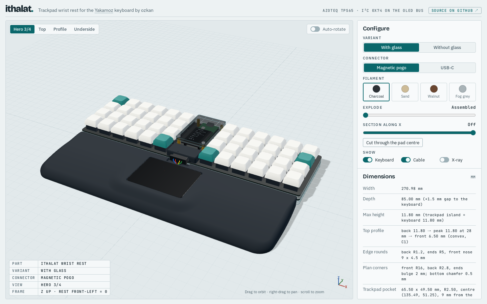

# ithalat

A 3D-printed wrist rest with a built-in trackpad for the [Yakamoz](https://github.com/ozkan/Yakamoz) keyboard.

[](https://github.com/Ardakilic/ithalat/actions/workflows/pages.yml)

## TL;DR

- **What it is:** a parametric, 3D-printed wrist rest with an Azoteq TPS65 I2C trackpad (65 x 49 mm) in its middle. It sits flush against the front of Yakamoz.
- **Two rest variants:** glass (for the 1.1 mm glass overlay) or bare.
- **Two connectors:** a 5-pin magnetic pogo pair, or a cheap USB-C breakout pair.
- **Pluggable:** the rest is not fixed to the keyboard. The firmware picks the pad up again when you plug it back in, and the OLED keeps working.
- **One config file:** every dimension comes from [`config.py`](config.py). Nothing is modelled by hand.
- **Open source:** [MIT License](LICENSE). The firmware in `firmware/` stays GPL-2.0-or-later.

> [!IMPORTANT]
> **Status: design stage.**
>
> - **Checked so far:** the generated parts pass 365 automated geometry checks. The firmware compiles and passes simulated tests.
> - **Not yet done:** no complete ithalat build on a real Yakamoz (printed, wired and used) is documented.
> - **So:** print one dock first as a fit test before you order everything.

**Jump to:**

- **Build one:** [What you need](#what-you-need) · [Pick your connector](#pick-your-connector) · [What to print](#what-to-print) · [Quick start](#quick-start)
- **Wire and flash:** [Wiring](#wiring-and-where-to-buy) · [Firmware](#firmware) · [Safety](#safety-notes)
- **Change the design:** [Building from source](#building-from-source) · [How the online preview is built](#how-the-online-preview-is-built)
- **About:** [Live preview](#live-preview) · [The name](#what-ithalat-means) · [Yakamoz](#built-for-yakamoz) · [Features](#features) · [Docs](#documentation) · [Credits](#credits) · [License](#license)

## Live preview

**[Open the live 3D preview](https://ardakilic.github.io/ithalat/)**

[](https://ardakilic.github.io/ithalat/)

- **Online:** <https://ardakilic.github.io/ithalat/>. GitHub Actions rebuilds it from source on every push, so it always matches the code in this repository.
- **All four combinations:** glass or bare rest, with the magnetic pogo or the USB-C connector.
- **Views:** x-ray, explode, section cut and the underside.
- **Info:** filament colours, dimensions, the parts with their masses, the pinout and the print notes.
- **Download:** the *Download STLs* block lists just the files your pick needs. Get them one by one, or all at once as a .zip.
- **Offline:** open [`preview/index.html`](preview/index.html) in a browser after cloning. It is one file, but it loads three.js and the fonts from a CDN, so it needs an internet connection and WebGL.

## What "ithalat" means

*ithalat* is Turkish for "import". The project is named this way because, since January 2026, people in Turkey cannot import anything internationally, and all vendors have closed shipping to Turkey because of this.

## Built for Yakamoz

ithalat is an add-on for **[Yakamoz](https://github.com/ozkan/Yakamoz)**, the 50-key ortholinear keyboard designed by [ozkan](https://github.com/ozkan). All credit for the keyboard goes to its author.

- **Hardware:** Yakamoz runs on a Raspberry Pi Pico with QMK. It has an OLED display, hot-swap sockets and an acrylic case.
- **Build guide:** <https://ozkancelik.com/yakamoz/>
- **QMK firmware:** <https://github.com/ozkan/Yakamoz-qmk>

What this means for you:

- **You need a built Yakamoz.** ithalat is only the wrist rest, the trackpad link and a keymap. It is not a keyboard.
- **The case is not modified.** You pull the two centre switches of the front (bottom) row, SW44 and SW43. A printed dock clips into their switch cut-outs.
- **Four wires run under the OLED cover.** You take the cover off to run them. Nothing is cut, filed or drilled, and you can undo it all.
- **Yakamoz has its own license.** Per its Readme, the Yakamoz keyboard is licensed under [Creative Commons Attribution-NonCommercial 4.0 International](https://creativecommons.org/licenses/by-nc/4.0/) (CC BY-NC 4.0). Its PCB design can be freely reproduced, modified and manufactured for personal use.
- **That license is ozkan's, for the keyboard.** ithalat's own files are MIT-licensed ([License](#license)).

## Features

### Shape and fit

- **Ergonomic shape:** a crowned, crease-free top, modelled on a classic walnut keyboard rest.
- **No step for your thumbs:** the back edge and the trackpad sit level with the switchplate (11.8 mm). Your thumbs slide from the front row onto the pad.
- **Low wrists:** the front drops to 6.5 mm.
- **Trackpad pocket:** the TPS65 drops in from the top onto a flat ledge, with its surface 0.15 mm below the rim. No glue, no screws. Two holes from below push it out again.
- **Glass or bare:** one rest STL per variant. One is for the 1.1 mm glass overlay, the other for the bare module (or a thin film).
- **No case modification:** the dock clips into the two empty switch cut-outs and can be removed again.
- **Hidden cable:** a short pigtail runs from the trackpad through an internal channel. It leaves through a notch in the back-top edge, right below the dock, so it is never pinched between the rest and the keyboard.
- **Optional ballast and bumpers:** pockets for two steel bars (about 122 g) keep the light rest from sliding. Six recesses take silicone bumpers.

### Electronics and firmware

- **Two connectors:** magnetic pogo (snaps on, breaks away safely) or a USB-C breakout pair (cheapest, no magnets near the pad). Same rest, same wiring inside the keyboard, same firmware.
- **Pluggable and hot-plug aware:** the keymap re-detects a re-plugged pad within about 1.3 s ([timing](firmware/README.md#hot-plug-behaviour-and-limits)). Stock QMK only looks for it at boot.
- **OLED keeps working:** the trackpad (0x74) shares the OLED's (0x3C) I2C bus on GP2/GP3. The OLED shows `Pad: on` / `Pad: --`.

### Build system

- **Parametric:** one source of truth, [`config.py`](config.py), for every dimension. You can override any constant from the command line, and the parts regenerate in seconds.
- **Self-checking:** `make verify` measures the generated meshes. The default build passes 365 checks, with 5 advisory warnings.
- **Reproducible:** everything runs in a pinned Docker image. The STLs reproduce byte for byte on the same CPU architecture.

## What you need

The full list, with part numbers, alternatives and costs, is in [docs/bom.md](docs/bom.md). The short version is below.

### For every build

- [ ] **A built Yakamoz keyboard** and a switch puller (the switches are hot-swap).
- [ ] **An Azoteq TPS65 trackpad module,** for example keycapsss KC10195_65, variant "TPS65". It is a 3.3 V only part.
- [ ] **A glass overlay,** 65 x 49 x 1.1 mm, for the glass variant only.
- [ ] **Wire and consumables:** very flexible 28 AWG and 30 AWG silicone wire, a short braided sleeve, heat-shrink and Kapton tape.
- [ ] **Filament:** PETG (recommended, especially for the docks) or PLA.
- [ ] **Tools:** a fine-tip soldering iron, a multimeter, flush cutters and a wire stripper.

> [!IMPORTANT]
> **Filament must be non-conductive:** no carbon-fibre or metal fill near the trackpad.

- **Buying in Turkey:** no Turkish shop that was checked sells the TPS65, its glass or M2 self-tapping screws ([where to buy](docs/where-to-buy.md#shared-parts-both-connectors)).

### Plus one connector

- [ ] **Magnetic pogo:** a 5-pin, 2.54 mm, N/S-keyed magnetic pogo pair.
  - Options: Adafruit 5413 / MG005, a generic pair, the Motorobit set, or the DIY version ([docs/bom.md, Cheaper magnetic options](docs/bom.md#7-cheaper-magnetic-options)).
- [ ] **Or USB-C:**
  - a female and a male 4-pad USB-C breakout board
  - a Schottky diode (1N5817, 1N5819 or SS14)
  - 4 x M2x4 self-tapping screws
  - 2-part epoxy

### Optional

- [ ] **Ballast:** two 78 x 20 x 5 mm steel bars.
- [ ] **Bumpers:** six Ø10 mm silicone bumpers, 0.6 mm taller than the keyboard's own.

## Pick your connector

The rest links to the keyboard through one of two connectors.

- **Same in both:** the four I2C wires, the taps inside the keyboard, the firmware and the rest STL.
- **Different:** only the dock and the parts at the end of the pigtail.

### At a glance

| | Magnetic pogo (default) | USB-C breakout pair |
|---|---|---|
| Plugging in | snaps on by itself: 5/5 | firm push, two hands: about 3/5 |
| Unplugging | lets go at a few newtons | 8–20 N straight pull |
| Breaks away if snagged | yes | no |
| Cheap option | generic pair: US$1–4 | boards you own: about US$0 |
| Magnets near the pad | two | none |
| Rated cycles | 20,000 | 10,000 |

### Which one?

- **Choose the pogo** if the rest should come and go with one hand and break away safely when something snags.
- **Choose USB-C** if you already own the breakout boards, want the cheapest build or want no magnets near the pad. You accept a two-handed plug-in.

> [!TIP]
> With USB-C, always hold the grip, never the wires. Plug and pull in a straight line ([plugging and unplugging](wiring.md#plugging-and-unplugging)).

### Where to go next

| | Magnetic pogo | USB-C |
|---|---|---|
| Print | rest + pogo dock | rest + USB-C dock + grip (2 halves) + retainer |
| Parts list | [bom.md, 2a](docs/bom.md#2a-magnetic-pogo-connector) | [bom.md, 2b](docs/bom.md#2b-usb-c-connector) |
| Wiring | [Step 1](wiring.md#step-1-keyboard-side-both-connectors), [2a](wiring.md#step-2a-magnetic-pogo-dock), [3](wiring.md#step-3-rest-side-trackpad-pigtail), [4](wiring.md#step-4-test-before-power-up) | [Step 1](wiring.md#step-1-keyboard-side-both-connectors), [2b](wiring.md#step-2b-usb-c-dock), [3](wiring.md#step-3-rest-side-trackpad-pigtail), [4](wiring.md#step-4-test-before-power-up) |

The rest is `stl/ithalat-glass.stl` or `stl/ithalat-bare.stl`, whichever matches your trackpad, for either connector.

<details>
<summary>Full comparison, row by row</summary>

**Keyboard half**

- Pogo: the flat-pad half of a 5-pin magnetic pogo pair, pressed into the pogo dock.
- USB-C: the blue **female** USB-C breakout board, captured in the USB-C dock behind a chamfered well.

**Rest half**

- Pogo: a spring-pin plug on a short pigtail.
- USB-C: the green **male** USB-C breakout board inside a printed grip.

**Parts cost**

- Pogo: US$6.95 (Adafruit 5413), US$1–4 generic, 216 TL (Motorobit), about 58–78 TL DIY ([docs/bom.md, Cheaper magnetic options](docs/bom.md#7-cheaper-magnetic-options)).
- USB-C: about US$0 with the boards you own. A new pair is about 57 TL in Turkey (Motorobit) or US$2–5 abroad, plus a Schottky diode (cents).

**Plugging in**

- Pogo: snaps on by itself and self-aligns: **5/5**.
- USB-C: a firm, straight push (5–20 N) while your other hand steadies the keyboard: **about 3/5**.

**Unplugging**

- Pogo: lets go at a few newtons.
- USB-C: 8–20 N. Brace a fingertip on the dock face and pull the grip straight back.

**Breakaway**

- Pogo: **yes**. A snag, or moving the rest, just pops it off.
- USB-C: **no**. Unplug before you move the rest, or it drags the keyboard along.

**RDY wire**

- Pogo: yes (optional pin 5).
- USB-C: no. The firmware works without it: it times its reads to the pad's report window. RDY only avoids clock-stretching waits on the shared bus.

**Metal near the pad**

- Pogo: two magnets, about 7.35 mm from the module (accepted; verify warns).
- USB-C: no magnets. The plug shell sits about 13 mm from the module, and the male board's copper pads about 5.5 mm (verify notes both as advisories).

**Contacts**

- Pogo: exposed flat pads on the dock face. The magnets pick up steel debris.
- USB-C: recessed in the receptacle. GND mates first.

**Mix-up risk**

- Pogo: none. Nothing else fits it.
- USB-C: the dock socket looks like a USB port. A series Schottky diode protects the keyboard. Label both halves "NOT USB".

**Rated cycles**

- Pogo: 20,000.
- USB-C: 10,000.

**Print**

- Pogo: the rest + `stl/ithalat-dock-pogo.stl`.
- USB-C: the rest + `stl/ithalat-dock-usbc.stl` + `stl/ithalat-usbc-grip-top.stl` + `stl/ithalat-usbc-grip-bottom.stl` + `stl/ithalat-usbc-retainer.stl`.

**Parts list**

- Pogo: [docs/bom.md, Magnetic pogo connector](docs/bom.md#2a-magnetic-pogo-connector).
- USB-C: [docs/bom.md, USB-C connector](docs/bom.md#2b-usb-c-connector).

**Wiring**

- Pogo: [Step 2a: Magnetic pogo dock](wiring.md#step-2a-magnetic-pogo-dock) and [Step 3: Rest side](wiring.md#step-3-rest-side-trackpad-pigtail).
- USB-C: [Step 2b: USB-C dock](wiring.md#step-2b-usb-c-dock) and [Step 3: Rest side](wiring.md#step-3-rest-side-trackpad-pigtail), where you also build the grip.
- Both: start with [Step 1: Keyboard side](wiring.md#step-1-keyboard-side-both-connectors).

</details>

## What to print

The STLs in [`stl/`](stl/) are committed and always match the default configuration. They are already in their print orientation.

| STL | Pogo | USB-C | What it is |
|---|:---:|:---:|---|
| [`ithalat-glass.stl`](stl/ithalat-glass.stl) **or** [`ithalat-bare.stl`](stl/ithalat-bare.stl) | yes | yes | the rest, for the TPS65 with or without the glass overlay |
| [`ithalat-dock-pogo.stl`](stl/ithalat-dock-pogo.stl) | yes | | keyboard dock that holds the pogo receptacle |
| [`ithalat-dock-usbc.stl`](stl/ithalat-dock-usbc.stl) | | yes | keyboard dock that holds the female USB-C board |
| [`ithalat-usbc-retainer.stl`](stl/ithalat-usbc-retainer.stl) | | yes | holds the female board down and locks the dock's clips (2 x M2x4) |
| [`ithalat-usbc-grip-top.stl`](stl/ithalat-usbc-grip-top.stl) | | yes | upper half of the grip around the male board |
| [`ithalat-usbc-grip-bottom.stl`](stl/ithalat-usbc-grip-bottom.stl) | | yes | lower half of the grip (2 x M2x4) |

### Screws and epoxy

- **USB-C: 4 x M2x4 self-tapping pan-head screws.** Two for the retainer, two for the grip.
- **USB-C: 2-part epoxy** for the plug shell in the grip.
- **Pogo: no screws.** The rest and the pogo dock need none.

### Print settings

- **No supports.**
- **Print as exported:** the rest bottom down, the docks upside down.
- **Layers:** 0.12–0.16 mm.
- **PETG for the docks:** their snap blades bend across the layer lines.
- **Fit test:** print one dock first.

The full table is in [docs/reference.md, Printing](docs/reference.md#printing).

## Quick start

- [ ] **1. Pick your connector:** [magnetic pogo or USB-C](#pick-your-connector).
- [ ] **2. Buy the parts** for that connector: [docs/bom.md](docs/bom.md). Example links are in [docs/where-to-buy.md](docs/where-to-buy.md).
- [ ] **3. USB-C only: measure your boards** and regenerate first ([Step 2b](wiring.md#step-2b-usb-c-dock), Part A).
- [ ] **4. Print** the rest variant that matches your trackpad, plus the parts for your connector ([What to print](#what-to-print)).
- [ ] **5. Wire it:** keyboard side, connector half and dock, then the pigtail in the rest. Follow [wiring.md](wiring.md). The short version is the [assembly order](docs/reference.md#assembly-order).
- [ ] **6. Beep-test before you power anything** ([Step 4: Test before power-up](wiring.md#step-4-test-before-power-up)).
- [ ] **7. Flash the firmware:** the `ardakilic_trackpad` QMK keymap ([Firmware](#firmware)).
- [ ] **8. Plug the pad in before the first power-up:** unplug USB, connect the trackpad, then plug USB back in.
- [ ] **9. Wait for `Pad: on`** on the OLED.
- [ ] **10. Calibrate:** do the [30-second calibration](firmware/README.md#calibration-30-seconds).

## Wiring and where to buy

**[wiring.md](wiring.md)** is the step-by-step wiring guide for both connectors. The deeper background is in [docs/wiring-details.md](docs/wiring-details.md).

- **Diagrams:** [magnetic pogo](docs/wiring.svg) and [USB-C](docs/wiring-usbc.svg).

| Step | What you do |
|---|---|
| [Step 1](wiring.md#step-1-keyboard-side-both-connectors) | keyboard side, both connectors |
| [Step 2a](wiring.md#step-2a-magnetic-pogo-dock) | magnetic pogo dock |
| [Step 2b](wiring.md#step-2b-usb-c-dock) | USB-C dock (keyboard half) |
| [Step 3](wiring.md#step-3-rest-side-trackpad-pigtail) | rest side: the pigtail, then the pogo plug or the USB-C grip |
| [Step 4](wiring.md#step-4-test-before-power-up) | test before power-up |

### The signals at a glance

| Signal | Pico pin | Pogo pin | USB-C pad | TPS65 pad |
|---|---|---|---|---|
| SDA | GP2 (pin 4) | 1 | D+ | SDA |
| 3V3 | 3V3(OUT) (pin 36) | 2 | V (via diode) | VDDHI |
| GND | GND (pin 38) | 3 | G | GND |
| SCL | GP3 (pin 5) | 4 | D− | SCL |
| RDY (optional) | GP15 (pin 20) | 5 | none | RDY |

> [!WARNING]
> **3V3 is never 5 V.** Take it from the Pico's 3V3(OUT), pin 36. On USB-C, the V pad gets 3V3 through a series Schottky diode.

### Where to buy

- **Example parts with links,** including USB-C breakout boards and magnetic pogo connectors: [docs/where-to-buy.md](docs/where-to-buy.md).
- **Full bill of materials,** with costs per connector: [docs/bom.md](docs/bom.md).

## Firmware

The firmware is a QMK keymap, `ardakilic_trackpad`, in [`firmware/`](firmware/). It is the same for both connectors. Details, calibration and the test checklist are in **[firmware/README.md](firmware/README.md)**.

### What it adds

- **TPS65 support:** through QMK's `azoteq_iqs5xx` pointing driver, on the OLED's I2C bus.
- **Tap to click:** a one-finger tap is a left click, a two-finger tap a right click.
- **Drag:** press and hold.
- **Scroll:** two fingers.
- **Mouse buttons:** the pad takes over the mouse buttons (`MS_BTN1`/`MS_BTN2`) of the two removed switches. Their SODA-layer functions are copied to other keys.
- **Hot-plug:** the keymap notices when the pad is plugged in or out and re-initialises it ([details](firmware/README.md#hot-plug-behaviour-and-limits)).

### Flash a prebuilt image

- [`firmware/build/yakamoz_ardakilic_trackpad.uf2`](firmware/build/yakamoz_ardakilic_trackpad.uf2): with the trackpad.
- [`firmware/build/yakamoz_ardakilic.uf2`](firmware/build/yakamoz_ardakilic.uf2): the baseline `ardakilic` keymap, without it.

1. Double-tap reset (or use `QK_BOOT` on the SODA layer).
2. Drop the `.uf2` onto the `RPI-RP2` drive.

### Build it yourself (Docker only)

```sh
cd firmware
./build.sh   # build the firmware
./test.sh    # simulated trackpad scenario tests (run after ./build.sh, which it reuses)
```

- **Image:** it builds inside the official `ghcr.io/qmk/qmk_cli` image, against upstream QMK.
- **Keyboard:** `keyboards/yakamoz` comes from [Ardakilic/qmk_firmware](https://github.com/Ardakilic/qmk_firmware).
- **Baseline keymap:** comes from [Ardakilic/qmk_userspace](https://github.com/Ardakilic/qmk_userspace).
- **Also in the owner's QMK userspace:** the same keymap is in [Ardakilic/qmk_userspace](https://github.com/Ardakilic/qmk_userspace) as `yakamoz:yakamoz_ithalat_trackpad` ([details](firmware/README.md#the-keymap-in-qmk_userspace)).

> [!NOTE]
> **Not yet tested on hardware.** The firmware compiles cleanly and passes the simulated scenario tests, but it has not run on a real Yakamoz with a real TPS65 yet. Work through the [test checklist](firmware/README.md#test-checklist-after-flashing) after the first flash.

## Building from source

You only need this if you change the design or want to rebuild the STLs and the preview.

- **You need:** only Docker and `make`.
- **Nothing is installed on your machine:** every command runs in the pinned `ithalat-build` image (python:3.14-slim + numpy/shapely/trimesh/manifold3d/matplotlib).
- **Runs as your user:** every target uses `-u $(id -u):$(id -g)`, so the outputs are not owned by root.

```sh
git clone https://github.com/Ardakilic/ithalat.git
cd ithalat
make all        # image -> generate -> verify -> preview
open preview/index.html   # macOS; xdg-open on Linux, or double-click the file
```

### Make targets

| Target | What it does |
|---|---|
| `make` / `make all` | `image`, `generate`, `verify`, `preview`, in that order |
| `make image` | builds the `ithalat-build` Docker image from `Dockerfile` + `requirements.txt` |
| `make generate` | runs `generate.py`: writes `stl/*.stl` and `build/manifest.json` (see below) |
| `make verify` | runs `tools/verify.py` on the STLs and the manifest; exits 1 on any failure |
| `make preview` | runs `tools/build_preview.py`: writes `preview/index.html` and `build/artifact.html` from the manifest |
| `make site` | assembles `_site/` the way GitHub Pages serves it; run `make all` first |
| `make shell` | interactive shell in the build image (for debugging) |
| `make clean` | deletes `build/`, `_site/` and the `__pycache__` folders |
| `make distclean` | `clean`, plus the committed deliverables (`stl/ithalat-*.stl`, `preview/index.html`) |

- **`make generate` also prints** sizes, volumes, triangle counts and the dimension summary.
- **`make site` contents:** `preview/index.html` as `index.html`, the STLs in `stl/`, and `.nojekyll`.
- **Build outputs:** every STL, `build/manifest.json`, the coordinate frame and the print orientations are listed in [docs/reference.md, Outputs](docs/reference.md#outputs).

### Overrides

Pass overrides in `GEN_ARGS`. Some common ones:

```sh
make generate verify GEN_ARGS="--glass-t 0.7"            # thinner glass (e.g. Azoteq's 0.7 mm option)
make generate verify GEN_ARGS="--depth 90"               # deeper rest
make generate verify GEN_ARGS="--connector usbc"         # only the USB-C dock and grip (plus the rests)
make preview                                             # refresh the preview for the new build
```

Rules:

- **Use the same `GEN_ARGS` for `generate` and `verify`.** `verify` measures the STLs in `stl/` against the config, so stale STLs fail.
- **Quote values** that contain parentheses, quotes or spaces inside `GEN_ARGS`, as in the `REST_PROFILE` example below.
- **Derived values are recomputed** after the overrides (list below).
- **Regenerate the defaults before committing:** `make generate verify preview` with no `GEN_ARGS`. The output is byte-identical for the same config and image.

<details>
<summary>More override examples</summary>

```sh
make generate verify GEN_ARGS="--height 13 --depth 90 --connector pogo5"   # taller, deeper rest (pogo only: at 13 mm the USB-C grip no longer clears the rest)
make generate verify GEN_ARGS="--engrave-face top --no-ballast"
make generate verify GEN_ARGS="--set KEYBOARD_HEIGHT=12.2"   # re-measured keyboard: REST_HEIGHT and the dock follow
make generate verify GEN_ARGS="--connector pogo5 --connector jst_sh4"   # pogo dock + Qwiic / JST-SH dock
make generate verify GEN_ARGS="--set 'REST_PROFILE=[(0,11.8),(30,11.8),(85,6.0)]'"
make preview                                             # refresh the preview for the new build
```

</details>

<details>
<summary>All flags</summary>

- **Flags:** `--height` (REST_HEIGHT), `--depth`, `--width`, `--glass-t`, `--tp-back-margin`, `--engrave-face bottom|top`, `--engrave-text`, `--no-ballast`, `--no-dock`, `--connector NAME` (repeatable), `--mesh-edge-len`.
- **`--set NAME=VALUE`** (repeatable) sets any constant in `config.py`. The value is a Python literal.
- **Unknown names** are rejected.
- **Every constant** is listed in [docs/reference.md, Configuration reference](docs/reference.md#configuration-reference).

</details>

<details>
<summary>Connector names (CONNECTORS)</summary>

- **`CONNECTORS`** in `config.py` lists the connector variants to build.
- **Default:** `('pogo5', 'usbc')`. The first entry is the one the preview shows first.
- **Names:** `pogo5` (magnetic pogo), `usbc` (USB-C breakout pair) and `jst_sh4` (Qwiic / JST-SH, still selectable).
- **One dock each:** `stl/ithalat-dock-pogo.stl`, `-usbc.stl`, `-jst.stl`. `usbc` also writes its grip parts.
- **`--connector NAME`** restricts the list for one run, and can be repeated.
- **Old syntax:** `--set DOCK_CONN_TYPE='jst_sh4'` still works. On its own, it builds just that connector.

</details>

<details>
<summary>Derived values (recomputed after overrides)</summary>

Derived values are recomputed after the overrides, unless you override them yourself. For example, `--glass-t` really changes the glass pocket. They are listed in the `DERIVED` table in `config.py`:

- `REST_WIDTH`, `REST_HEIGHT`, `REST_BACK_HEIGHT`
- `TP_CENTER_X`, `VARIANTS`
- `CABLE_TUNNEL_H`, `CABLE_NOTCH_LEN`, `CABLE_NOTCH_X`
- `PLUG_BAY_L`, `PLUG_BODY`
- `DOCK_CENTER_X`, `DOCK_SWITCH_CENTER_Y`, `DOCK_PLATE_T`, `DOCK_UNDERPLATE_GAP`
- `KB_X0`

</details>

### Verification in short

- **What it measures:** the meshes themselves, with ray casts, slices, point-in-solid tests and signed distances.
- **What it checks:** mesh health, sizes, the trackpad pocket, the cable path, the plug clearance, the underside, every dock, the USB-C parts and the assembled positions.
- **Result:** the default build passes 365 checks with 5 advisory warnings (the pogo plug magnets and the USB-C metal distances near the pad).
- **On failure:** it exits 1.
- **Full list of checks:** [docs/reference.md, Verification](docs/reference.md#verification).

### Pinned toolchain

- **Why it is pinned:** so the STLs reproduce byte for byte on the same CPU architecture.
- **Other CPUs:** an x86_64 machine (such as the GitHub Actions runner) can split a few triangles of an arm64-built STL along the other diagonal. Same vertices, volume and geometry; different bytes.
- **To bump a pin:** run `make all`, and commit the regenerated STLs together with the change.

<details>
<summary>Pinned versions</summary>

Python 3.14, numpy 2.5.3, shapely 2.1.2, trimesh 5.1.0, manifold3d 3.5.3, mapbox_earcut 2.1.0, matplotlib 3.11.2, plus rtree, scipy and networkx for the verifier.

</details>

## How the online preview is built

- **Where:** <https://ardakilic.github.io/ithalat/>, built by GitHub Actions from [`.github/workflows/pages.yml`](.github/workflows/pages.yml).
- **When:** on every push to `main`, and on demand from the Actions tab.
- **How:** the same Docker build image and `make` targets as a local build: `make image`, then `make generate verify preview site`.
- **What it does:** regenerates the parts and `build/manifest.json`, runs the self-test, rebuilds the preview with `tools/build_preview.py` and deploys it to GitHub Pages.
- **Job summary:** lists any regenerated file that differs from the committed copy.

> [!NOTE]
> **If `tools/verify.py` fails, nothing is deployed.** The last good page stays up.

- **STLs online:** the site also serves the STLs, at `https://ardakilic.github.io/ithalat/stl/<file>.stl`. The page's download links use these copies. The offline copy downloads the committed files from this repository instead.
- **Offline copy:** the committed [`preview/index.html`](preview/index.html) is the same page.
- **Badge:** the badge at the top of this README shows the state of the last run.
- **Forks:** enable Pages in *Settings > Pages* with *Source: GitHub Actions*, and your fork publishes its own preview.

## Safety notes

> [!WARNING]
> **Never plug the USB-C halves into real USB.**
>
> - **Not a USB port:** after the conversion, the dock carries I2C and 3.3 V, not USB. Neither half is a USB port.
> - **Keyboard side:** the Schottky diode protects the keyboard from a charger's 5 V.
> - **Rest side:** the grip has no protection. Plugging it into a laptop, phone or charger can put 5 V on the trackpad and kill it.
> - **Label both halves "NOT USB"** ([Safety first](wiring.md#safety-first)).

> [!IMPORTANT]
> **The TPS65 is a 3.3 V part** (3.6 V max). Power it from the Pico's 3V3(OUT) only. Never from 5 V, VSYS or VBUS.

- **Solder with the keyboard unplugged** from USB.
- **Beep-test the wiring** before the first power-up.
- **Keep metal away from the pad:** no conductive or metal-filled filament, and no loose steel, magnets or coins within about 15 mm of the module. It does not damage anything, but it disturbs the capacitive sensing.
- **Pogo pads are exposed live contacts,** and the magnets pick up steel debris.
- **Optional protection parts** (TVS, series resistors, a PTC fuse): see [docs/wiring-details.md, Optional protection parts](docs/wiring-details.md#optional-protection-parts) and [docs/bom.md, Optional protection parts](docs/bom.md#3-optional-protection-parts-keyboard-side-at-the-dock).

## Documentation

| Doc | What is in it |
|---|---|
| [wiring.md](wiring.md) | step-by-step wiring for both connectors: pinout, soldering, tests |
| [docs/wiring-details.md](docs/wiring-details.md) | the deeper wiring background behind wiring.md, such as the electrical notes |
| [docs/wiring.svg](docs/wiring.svg), [docs/wiring-usbc.svg](docs/wiring-usbc.svg) | wiring diagrams: pogo, USB-C |
| [docs/bom.md](docs/bom.md) | bill of materials and costs, per connector |
| [docs/where-to-buy.md](docs/where-to-buy.md) | example shops with links, prices and stock (checked 2026-11-15), Turkish shops first |
| [docs/reference.md](docs/reference.md) | the detailed reference (sections below) |
| [firmware/README.md](firmware/README.md) | QMK keymap `ardakilic_trackpad`: azoteq_iqs5xx driver, hot-plug, calibration; same for both connectors |
| [preview/index.html](preview/index.html), [online](https://ardakilic.github.io/ithalat/) | interactive 3D preview of the assembly; switch between glass/bare and the two connectors |

**docs/reference.md sections:** [design rationale](docs/reference.md#design-rationale) · [outputs](docs/reference.md#outputs) · [verification](docs/reference.md#verification) · [variants](docs/reference.md#variants) · [the docks](docs/reference.md#the-docks) · [configuration reference](docs/reference.md#configuration-reference) · [printing](docs/reference.md#printing) · [assembly order](docs/reference.md#assembly-order) · [ballast and bumpers](docs/reference.md#ballast-and-bumpers) · [glass handling](docs/reference.md#glass-handling) · [troubleshooting](docs/reference.md#troubleshooting)

## Repository layout

<details>
<summary>Show every file and folder</summary>

| Path | Role |
|---|---|
| `config.py` | every dimension (single source of truth) |
| `generate.py` | CLI: builds all parts for every connector in `CONNECTORS`, writes STLs + `build/manifest.json` |
| `geometry/rest.py` | outline, C1 top surface, pocket, cable, underside |
| `geometry/dock.py` | keyboard docks (plugs, snap clips, connector pocket or USB-C well, wire paths) |
| `geometry/plug.py` | pigtail plug envelope (housing + strain relief) and the per-variant cable route |
| `geometry/connectors.py` | connector variants: ids, labels, per-connector config copies, pin tables, the pogo / JST hardware envelopes |
| `geometry/usbc.py` | USB-C variant (full list below the table) |
| `geometry/common.py`, `geometry/text.py`, `geometry/cfg.py` | helpers, engraving text (matplotlib TextPath), config loading/overrides |
| `tools/verify.py` | geometry and assembly self-test |
| `tools/build_preview.py`, `preview/template.html` | preview builder |
| `preview/index.html` | the built preview (committed) |
| `stl/` | the committed STLs for the default config |
| `wiring.md`, `docs/wiring-details.md`, `docs/wiring.svg`, `docs/wiring-usbc.svg` | wiring guide, deep wiring detail and diagrams (pogo, USB-C) |
| `docs/bom.md` | bill of materials |
| `docs/where-to-buy.md` | example shop listings with prices and stock |
| `docs/preview.png` | screenshot of the live preview, shown at the top of this README (not regenerated by the build) |
| `docs/reference.md` | detailed reference (design, verification, config, printing, assembly, troubleshooting) |
| `firmware/` | QMK keymap `ardakilic_trackpad`, `build.sh`, `test.sh`, scenario tests, prebuilt `.uf2` images in `firmware/build/` |
| `.github/workflows/pages.yml` | GitHub Actions workflow that builds and deploys the online preview |
| `Dockerfile`, `requirements.txt`, `Makefile` | pinned build environment |
| `LICENSE` | the MIT License text |
| `build/`, `_site/` | scratch outputs (git-ignored): the manifest and artifact page, and the Pages site from `make site` |

**`geometry/usbc.py` in full** (the USB-C variant):

- dock well, shoulder window with crush ribs and board pocket;
- screwed retainer with shell press ribs, lock prongs and diode cradle;
- grip clamshell (epoxy key groove, clamp ribs, collar);
- hardware boxes, retention and hold-down calculation;
- cable route to the male pads.

</details>

## Credits

- **[ozkan](https://github.com/ozkan)** for the [Yakamoz](https://github.com/ozkan/Yakamoz) keyboard that ithalat is built around. The keyboard dimensions come from its KiCad and DXF files.
- **Azoteq** for the TPS65 trackpad module and its IQS550 controller, the datasheets and the application notes (AZD068 for the metal keep-out).
- **[QMK](https://qmk.fm/)** for the firmware and its `azoteq_iqs5xx` pointing driver.
- **[three.js](https://threejs.org/)** for the 3D preview.
- **[trimesh](https://trimesh.org/), [manifold3d](https://github.com/elalish/manifold), [shapely](https://shapely.readthedocs.io/)**, numpy, scipy and matplotlib, which generate and verify the geometry.

## License

ithalat is released under the **[MIT License](LICENSE)**. Copyright (c) 2026 Arda Kılıçdağı.

- **Covers:** ithalat's own files. That is the generator (`config.py`, `generate.py`, `geometry/`, `tools/`), the STLs in `stl/`, the preview, `wiring.md`, the diagrams and the other docs.
- **You may:** use, copy, modify, merge, publish, distribute, sublicense and sell it, for any purpose.
- **You must:** keep the copyright notice and the license text in all copies or substantial portions.
- **No warranty:** it is provided "as is". The authors are not liable for any claim or damages.

### Exceptions and third-party parts

- **`firmware/` stays [GPL-2.0-or-later](https://github.com/qmk/qmk_firmware/blob/master/LICENSE).**
  - The keymap is based on ozkan's GPL keymap. Its `keymap.c` header says "Copyright 2023 ozkan" (QMK keymap code, Copyright ozkan and contributors).
  - It builds into QMK, and the prebuilt `.uf2` images are built from QMK.
  - So the MIT license does not cover `firmware/` or the `.uf2` images. The GPL governs their use, including commercial use.
- **Yakamoz keyboard:** the design is ozkan's.
  - It is licensed under [CC BY-NC 4.0](https://creativecommons.org/licenses/by-nc/4.0/), per the [Yakamoz Readme](https://github.com/ozkan/Yakamoz).
  - The MIT license covers only ithalat's own files, not the keyboard.
- **three.js (MIT license):** the preview loads it from a CDN. It is not included in this repository.
