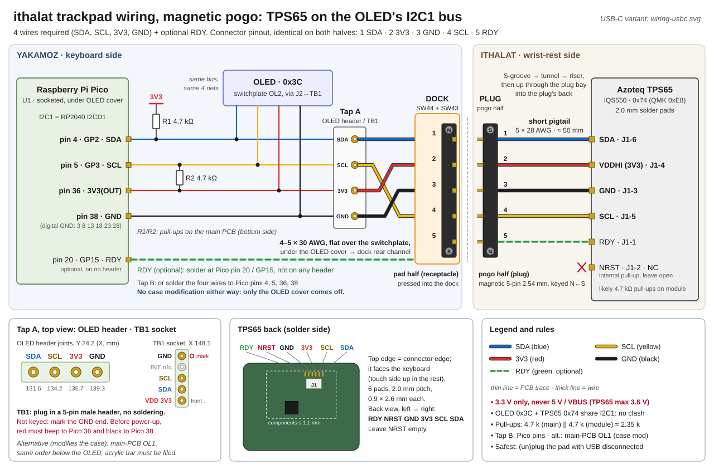

# ithalat wiring: TPS65 trackpad to the Yakamoz

This guide connects the Azoteq TPS65 trackpad in the *ithalat* wrist rest to the [Yakamoz](https://github.com/ozkan/Yakamoz) keyboard. The link uses one of two connectors: a **5-pin magnetic pogo** pair or a **USB-C breakout pair** ([how to choose](README.md#pick-your-connector)). The OLED keeps working, and no PCB traces are cut.

**The recommended wiring does not modify the case.** You pull two hot-swap switches and take off the OLED cover; nothing is cut, filed or drilled, and the switchplate stays in place. The wires lie on top of the switchplate, under the OLED cover, and run into the printed dock's rear channel (§3.3, §3.4). An under-plate alternative exists, but it means filing an internal acrylic part, so it comes last.

## Wiring at a glance

The trackpad joins the I2C bus that the Yakamoz already uses for its OLED. You need **four wires** (SDA, SCL, 3V3, GND), plus an optional fifth (RDY) with the magnetic pogo only. The firmware is the same for both connectors.

| Signal | Wire colour | Pico pin (keyboard) | Magnetic pogo pin | USB-C breakout pad | TPS65 pad (J1 pin) |
|---|---|---|---|---|---|
| SDA | blue | pin 4, GP2 | 1 | D+ | SDA (J1-6) |
| 3V3 | red | pin 36, 3V3(OUT) | 2 | V, through a series Schottky diode (band toward V) | VDDHI, silk "3V3" (J1-4) |
| GND | black | pin 38, or any digital GND | 3 | G | GND (J1-3) |
| SCL | yellow | pin 5, GP3 | 4 | D− | SCL (J1-5) |
| RDY (optional) | green | pin 20, GP15 | 5 | none | RDY (J1-1) |
| NRST | none | none | none | none | NRST (J1-2): leave unconnected |

You do not have to solder at the Pico: the same four nets are on the OLED header joints and the switchplate TB1 socket, under the OLED cover (tap A, §3.4). §2 has the full table with board positions. Three rules: **3.3 V only** (never Pico pin 39 VSYS or pin 40 VBUS), **NRST stays unconnected**, and with USB-C **the Schottky is required** (§7.3).

**Magnetic pogo:**



**USB-C:**


**Which steps apply to me?**

- **Both connectors, keyboard side:** pull SW44 and SW43, pick a tap point and run the wires over the plate ([§3.1–3.4](#31-before-you-start)). The electrical notes in [§5](#5-electrical-notes) apply to both.
- **Magnetic pogo:** receptacle and dock ([§3.5](#35-magnetic-pogo-solder-the-receptacle-and-fit-the-dock)), rest side and plug ([§4](#4-wrist-rest-side-step-by-step)), tests ([§6](#6-test-procedure)).
- **USB-C:** everything is in [§7](#7-usb-c-variant): the diode (§7.3), the boards (§7.4), the dock (§7.5), the grip (§7.6), tests (§7.7) and [plugging and unplugging](#78-plugging-and-unplugging) (§7.8). It also uses §4 steps 1–5, 7 and 8.
- **Parts:** [Example parts and where to buy](#example-parts-and-where-to-buy), and the full list in [docs/bom.md](docs/bom.md).
- **Both columns side by side, step by step:** [How to use this guide](#how-to-use-this-guide).

## How to use this guide

The keyboard taps and the wire route are the same for both connectors. Only the connector halves, the dock and the rest end of the pigtail differ. Follow your column:

| Step | Magnetic pogo | USB-C |
|---|---|---|
| Understand the link | §1, §2 | §1, §2, then §7.1–7.3 |
| Keyboard: pull the switches, pick a tap, route the wires | §3.1–3.4 (4 wires, 5 with RDY) | §3.1–3.4, tap A or B and the over-plate route only (4 wires, no RDY) |
| Keyboard: connector half and dock | §3.5 | §7.4, §7.5 |
| Rest: pigtail, cable route, glass, module | §4 | §4 steps 1–5, then §7.6 (which includes §4 steps 7–8) |
| Electrical notes | §5 | §5, plus §7.3 and §7.9 |
| Tests | §6 | §7.7, then §6 from "First power-up" |
| Plugging and unplugging | §4 step 9, §5 "Hot-plug" | §7.8, §7.10 |
| Diagram | [wiring.svg](docs/wiring.svg), §9.1 | [wiring-usbc.svg](docs/wiring-usbc.svg), §9.2 |
| Parts | [docs/bom.md §2a](docs/bom.md#2a-magnetic-pogo-connector), [examples](#example-parts-and-where-to-buy) | [docs/bom.md §2b](docs/bom.md#2b-usb-c-connector), [examples](#example-parts-and-where-to-buy) |

**Conventions used in this guide**

- **Keyboard positions** are in mm in the keyboard's top-view frame. The origin is the keyboard's front-left corner. X runs to the right as the typist sees it, Y runs towards the back (USB end), and Z runs up.
- **Mirrored KiCad file.** The main-PCB KiCad file is drawn from the *bottom*, so its X axis is mirrored. Every position here has already been converted to the top view.
- **TPS65 orientation.** "Back view" means the component side, with the connector edge at the top. When the module is mounted in the rest, its touch side faces up and its connector edge faces the keyboard.
- **Config names.** Names in `UPPER_CASE` refer to [`config.py`](config.py).
- **Firmware.** Firmware settings are in [`firmware/`](firmware/). The firmware is the same for both connectors.

---

## 1. Overview

**The trackpad shares the OLED's I2C bus. Nothing is re-routed, and the OLED stays.**

- **The bus already exists.** The Yakamoz drives its OLED on RP2040 **I2C1**: SDA = **GP2** (Pico pin 4) and SCL = **GP3** (pin 5). The main PCB has 4.7 kΩ pull-ups R1/R2 to 3V3.
- **The TPS65 joins that same bus.** Its controller is an IQS550.
- **Why sharing works:**
  - *Different addresses.*
    - OLED: 7-bit **0x3C**.
    - TPS65: 7-bit **0x74** (QMK writes it as 8-bit `0xE8`).
    - Pimoroni trackball option: **0x0A**.
    - No two are the same, so each device answers only to its own address.
  - *QMK supports only one I2C peripheral.* Sharing I2C1 is the intended setup, not a workaround. QMK runs all I2C transfers one after another in a single thread, so the OLED and the trackpad never talk over each other.
  - *The PCB was already built for a second I2C device.* The trackball header TB1 is on the same SDA/SCL nets as the OLED.
- **Four wires are required:** **SDA, SCL, 3V3, GND**. QMK's `azoteq_iqs5xx` driver uses only these four. This is the same four-wire setup the owner uses with the same driver on a cost_crafter40 keyboard.
- **A fifth wire, RDY, is optional, and only the magnetic pogo carries it.** It goes to **GP15 (Pico pin 20)**.
  - With it, QMK reads the pad only while RDY is high, through `POINTING_DEVICE_MOTION_PIN GP15`. This avoids clock-stretching stalls on the shared bus.
  - Without it, QMK simply polls the pad every 11 ms. That is what the USB-C variant does (an advanced mod exists, §7.11).
- **NRST is not connected.** It has an internal 30–60 kΩ pull-up.
- **The connector is one of two.** Both docks replace the two front-row centre switches SW44 and SW43, and both use the same taps, wire route and rest.
  - **Magnetic pogo:** a 5-pin, 2.54 mm magnetic pogo pair.
    - The **flat-pad half** (receptacle) is press-fitted in the 3D-printed pogo **dock**.
    - The **spring-pin half** (plug) sits on a short pigtail. The pigtail is soldered to the TPS65 pads and runs through the rest's internal channel. Its last 15 mm of loose wire rises out of the notch and plug bay on the centre line, straight into the back of the plug, which hangs on the dock face over the rest's back edge. With the default rest, the route from the pads to the dock face is about 52 mm.
  - **USB-C:** a cheap USB-C breakout pair (§7).
    - The blue **female** board is captured in the USB-C dock. Its receptacle sits at the bottom of a chamfered well in the dock face.
    - The green **male** board sits in a printed **grip** on a short lead from the TPS65. The lead runs through the same channel as the pogo pigtail.
    - The 3V3 line passes through a series Schottky diode at the keyboard end.
- **Pointing driver.** The trackpad and a PIM447 trackball cannot both be the QMK pointing driver. Leave the trackball out, or write a `custom` driver.

```
Pico GP2/GP3/3V3/GND ── main-PCB traces (R1/R2 4.7k) ── J2/TB1 link ── switchplate ── OLED (0x3C)
   │                                                                       │
   tap B: Pico pins 4/5/36/38                     tap A: OLED header joints or switchplate TB1
   (+ RDY: Pico pin 20, any tap, pogo only)                                │
   │                                                                       │
   └──── 4-5 x 30 AWG, flat on the switchplate, under the OLED cover ──────┘
                                     │
                     dock rear channel (no case modification)
                                     │
  pogo:   dock: pogo receptacle   ◄─ magnets ─►  plug ── short pigtail ── TPS65 (0x74)
  USB-C:  dock: Schottky + female ◄─ push ───►  male in grip ── short lead ── TPS65 (0x74)
```

---

## 2. Signal table

The **pogo** pinout is the same on both halves: **1 SDA · 2 3V3 · 3 GND · 4 SCL · 5 RDY** (`CONNECTOR_PINOUT`).

- **GND is pin 3, the centre pin.** It stays in the middle even if a half is wired mirror-image.
- **SDA and SCL are separated** by the two power pins. This follows the I2C cable practice of keeping each signal line next to a power or ground conductor.

The **USB-C** variant uses the four pads both breakout boards already have: **G = GND, V = 3V3 (through a series Schottky), D+ = SDA, D− = SCL** (§7.2). It has no RDY.

The keyboard-side columns are in order of preference. Taps A and B need no case modification; the main-PCB OL1 alternative does (§3.4).

| Pogo pin | USB-C pad | Signal | Wire colour | **Tap A** (recommended): OLED header joint · switchplate TB1 / OL1 hole | **Tap B**: Pico pin / GPIO | *Alternative (modifies the case)*: main-PCB OL1 hole | TPS65 pad (J1 pin) |
|---|---|---|---|---|---|---|---|
| **1** | **D+** | SDA | **blue** | OLED "SDA" (X 131.6) · TB1 "SDA" Y 62.9 · OL1 "SDA" Y 46.2 | **pin 4**, GP2 (I2C1 SDA) | OL1-1, leftmost (X 131.6) | **SDA** (J1-6) |
| **2** | **V**, through the Schottky | 3V3 | **red** | OLED "VCC" (X 136.7) · TB1 "VDD" Y 60.3 · OL1 "VCC" Y 51.2 | **pin 36**, 3V3(OUT) | OL1-3 (X 136.7) | **VDDHI**, silk "3V3" (J1-4) |
| **3** | **G** | GND | **black** | OLED "GND" (X 139.3) · TB1 "GND" Y 70.5 · OL1 "GND" Y 53.8 | **pin 38**, or any digital GND: 3, 8, 13, 18, 23, 28 | OL1-4 (X 139.3) | **GND** (J1-3) |
| **4** | **D−** | SCL | **yellow** | OLED "SCL" (X 134.2) · TB1 "SCL" Y 65.4 · OL1 "SCL" Y 48.7 | **pin 5**, GP3 (I2C1 SCL) | OL1-2 (X 134.2) | **SCL** (J1-5) |
| **5** | none (§7.11) | RDY (optional) | **green** | *not on any header*: use Tap B's pin | **pin 20**, GP15 | none | **RDY** (J1-1) |
| none | none | NRST | none | none | none | none | **NRST** (J1-2): **leave unconnected** |

**Notes on the table**

- **Wire colours** follow the Qwiic / STEMMA QT convention: black GND, red 3V3, blue SDA, yellow SCL. The USB-C variant and the JST-SH variant in §8 use the same colours.
- **USB-C pad names** are the breakout boards' silk labels. The male board reads V, D−, D+, G. The female may only read G, D, D, V; §7.2 shows how to tell its two D pads apart.
- **OLED header joints.** The OLED module plugs into switchplate OL2, directly above main OL1, at Y **24.2** on the keyboard centre line X 135.49. Seen from the top, left to right, its pins are **SDA, SCL, VCC (3V3), GND**.
- **Switchplate TB1** is at X 148.1. Its fourth hole (INT, Y 67.9) is not connected.
- **Switchplate OL1** is at X 148.3.
- **Pico pin 33 is AGND**, the ADC's ground return. Use a digital GND pin.
- **Main-PCB OL1** holes (the alternative) sit right below the OLED header, at the same X and Y and in the same order.
- **Pico pin positions:**
  - Left row: X 126.6. Pin 4 is at Y 69.2, pin 5 at 66.7, pin 18 at 33.6, pin 20 at 28.6.
  - Right row: X 144.4. Pin 23 is at Y 33.6, pin 36 at 66.7, pin 38 at 71.7.
  - Pin 1 is the back-left pin, next to the USB connector.
- **TPS65 pads, back view, left to right:** RDY, NRST, GND, VDDHI, SCL, SDA.
  - Pitch is 2.0 mm. Each pad is about 0.9 × 2.6 mm.
  - The pads are 4.9–7.1 mm from the connector edge.
  - In the touch-side (front) view the order reverses to SDA … RDY. That is the order of `TP_PAD_NAMES`.
- **Pin 1 of the pogo connector** is the end at the **typist's left** when you look at the dock face from the wrist rest. Mated pins touch each other, so the same number touches the same number on both halves.

---

## 3. Keyboard side, step by step

§3.1 to §3.4 are the same for both connectors. §3.5 is for the magnetic pogo; USB-C continues at §7.4.

### 3.1 Before you start
- **Unplug USB.** Work on an anti-static mat, or at least touch something grounded first.
- **Tools:** a fine-tip iron (about 330 °C), 0.5 mm solder, flux, a multimeter, tweezers, a keycap puller, a switch puller, 1.5 mm heat-shrink and Kapton tape. For tap A at the TB1 socket, add a 5-pin 2.54 mm male header. You need a needle file only for the alternative under-plate route, which modifies the case.
  - **USB-C also needs** a Schottky diode (§7.3) and hot tweezers or a second iron to lift two tiny resistors (§7.4).
- **Print and test-fit the dock for your connector first.**
  - **Magnetic pogo:** measure your pogo pair. It should match `DOCK_CONN_W/H/D` = 20.1 × 4.2 × 4.0 mm. Generic pairs vary. If yours is different, change those values and regenerate.
  - **USB-C:** measure both breakout boards and set the `USBC_*` constants (§7.4). Cheap boards vary by seller.

### 3.2 Remove SW44 and SW43
1. Find the two **centre keys of the front row**:
   - **SW44** is left of centre, at X 125.95.
   - **SW43** is right of centre, at X 145.00.
   - Both are at Y 11.93, at matrix positions [3,6] and [3,7].
   - The keymap leaves MS_BTN1/MS_BTN2 at these positions. They go dead once the switches are pulled, and trackpad taps replace them.
   - On the SODA layer these positions carry QK_AUDIO_VOICE_NEXT and QK_MUSIC_TOGGLE. The `ardakilic_trackpad` keymap also copies them to [3,4] and [3,9], so they stay reachable.
2. Pull both keycaps. Then pull both switches with a switch puller. The sockets are hot-swap, so there is nothing to desolder. Keep the parts.
3. Nothing needs cutting:
   - GP13 and GP16 now lead only to empty sockets.
   - The diodes stay in place.
4. Look into the two 14 mm cut-outs. Underneath is the 4.0 mm gap down to the main PCB.

### 3.3 Where wires can (and cannot) run
Under the switchplate, the 4.0 mm gap is filled by the upper-middle acrylic layer except where it has openings.

- **Under the dock**, the opening is a **34.1 × 16.0 × 4.0 mm pocket** (X 118.9–153.1, Y 4.0–20.0).
  - A 2.1 mm acrylic finger runs from its front wall back to Y 16.1.
  - Behind the finger, a 3.9 mm passage joins the left and right halves.
  - Wires can run freely here and come up into the dock.
- **The pocket is closed at the back.**
  - A **2.9 mm acrylic bar** (Y 20.0–22.9) separates it from the 12.0 × 3.6 mm slot (Y 22.9–26.5) where the main-PCB **OL1** holes are.
  - The Pico window begins further back, at Y 25.9, and is also walled off.
- **So there is no ready-made under-plate path** from OL1 or the Pico to the dock. There are two routes:
  - **Over-plate route (recommended, no case modification)**, for taps A and B. The wires lie flat on top of the switchplate and run under the raised OLED cover (its underside is about 9.2 mm above the plate as modelled; `OLED_COVER_T` is an estimate, so measure yours). They come out under its front edge at Y 22.1 and cross the short strip of open plate to the dock's back face (about 2.5 mm with the pogo dock, Y ≈ 19.6; the USB-C dock is deeper: its back face is at Y ≈ 21.5, only 0.6 mm from the cover edge, but its top stays 0.2 mm under the cover's underside, so it still fits if your cover edge sits a little further forward). No acrylic work is needed; only the OLED cover comes off.
  - **Under-plate route (alternative, modifies the case)**, for main-PCB OL1 only. You file a small notch in that acrylic bar. The notch is hidden inside the case, but the whole switchplate has to come off and an internal part is altered for good.
- **RDY can only be soldered at the Pico**, which sits above the switchplate. If you wire RDY, it always takes the over-plate route.
- **Which dock takes which route:**
  - **Rear wire channel** (both docks), for the over-plate route: open at the bottom, leaving the dock's back face at plate level on the keyboard centre line, between the two plugs. Pogo dock 3.0 × 2.8 mm (`DOCK_REAR_CH_W`/`_H`), USB-C dock 4.0 × 3.9 mm (`USBC_REAR_CH_W`/`_H`). Wires lie flat on the plate, and the dock is pressed down over them.
  - **Ø 5 mm hole down into each plug** (`DOCK_WIRE_HOLE`), **pogo dock only**, for the under-plate route or a small protection board under the plate. The plugs are hollow and open at the bottom into the 4 mm gap.
  - **The USB-C dock has no hole**: its female board, the retainer screws and the clip-lock prongs fill the space above the plugs. With USB-C, use tap A or B and the over-plate route.

### 3.4 Choose a tap point

Use **tap A** if one of its points is free, otherwise **tap B**. Both sit on top of the switchplate under the OLED cover, and both use the over-plate route below. The main-PCB OL1 alternative at the end of this section is for builders who accept modifying the case.

#### Tap A (recommended): switchplate pins, on top of the plate under the OLED cover
Remove only the OLED cover (4 screws). These points are on the same four nets as the Pico pins. Pick one, in this order:

1. **Switchplate TB1** (trackball socket, X 148.1). From back to front: **GND, INT (n/c), SCL, SDA, VDD**.
   - If a female socket is already fitted and no trackball is used, plug in a 5-pin male header with the wires soldered to it. **No soldering on the keyboard** is needed.
   - Do not use the INT pin. Leave its header pin empty or cut it off.
   - **The header is not keyed.** Plugged in the wrong way round, it swaps GND and VDD (and SDA and SCL), and that puts −3.3 V on the trackpad, which is rated for −0.3 V at most. So:
     - mark the GND end on the header and on the board with a paint dot, or use a polarized housing, or glue the header in once it is tested;
     - **before every power-up after re-seating it** (for example after the OLED cover was off), check with the meter that the red wire beeps to Pico pin 36 and the black wire to pin 38. With USB-C, the red wire meets the Schottky's anode; check it there, before the diode.
2. **The OLED module's own header-pin joints** (switchplate OL2). Solder thin wires to them.
   - Top view, left to right, X 131.6 / 134.2 / 136.7 / 139.3: **SDA, SCL, VCC, GND** (the same order as main OL1 underneath). Confirm each one with the meter.
   - This is the shortest route: the joints are only about 5 mm behind the dock.
   - Be quick, because the display glass is close by. Unplug the module to solder it if you can, and note which way round it was.
3. **Switchplate OL1** (alternative OLED position, X 148.3). From back to front: **GND, VCC, SCL, SDA**. Use it if its holes are empty.

**Do not tap the J2 ↔ TB1 board-to-board link.** Its pin 4 is the switchplate RGB data line (GP1).

#### Tap B: directly on the Pico pins
Solder to the top-side joints of the Pico's header pins:

- **pin 4 (SDA)** and **pin 5 (SCL)**, left row;
- **pin 36 (3V3)** and **pin 38 (GND)**, right row.
  - Pin 23 or pin 18 (both GND, Y 33.6) is closer to the front.

Unplug the OLED module while you work. It covers the front of the Pico.

**Never bridge pins 36, 37 and 38.**
- Pin 37 is **3V3_EN**. Shorting it to GND switches the 3V3 regulator off.
- Pins **39 (VSYS) and 40 (VBUS) are 5 V.** Never connect them to the trackpad, with either connector.

#### Optional RDY wire (magnetic pogo only)
- Solder a green 30 AWG wire to **Pico pin 20 = GP15**. It is the front-most pin of the left row (X 126.6, Y 28.6), at the Pico's front-left corner. It is **not on any header**, so you must solder at the Pico.
- Route it over the plate to the dock, together with the other wires.
- Leave dock pin 5 empty if you skip RDY.
- **USB-C:** skip this. The standard USB-C build has no RDY (§7.11).

#### Over-plate route (taps A and B)
1. Run the wires flat on the switchplate, under the cover:
   - from TB1 or switchplate OL1, forward along the free strip between the Pico and the right-hand key block (X ≈ 146–153);
   - from the OLED header, straight forward;
   - from the Pico pins, forward the same way, without lifting the OLED module.
2. Bring them out under the cover's front edge (Y 22.1) and across the open plate to the dock's back face. There they enter the **rear wire channel**, centred on the keyboard centre line.
3. Keep them flat and tack them down with Kapton. Black Kapton hides the short visible stretch.
4. Do not run them over the Pico's USB connector, or under the OLED module where they would lift it.
5. Refit the OLED module (the right way round) and the cover.

#### Alternative (modifies the case): main-PCB OL1 holes, under the switchplate
Use this only if you accept modifying the case, and **only with the magnetic pogo dock** (the USB-C dock has no wire hole into its plugs). It needs a notch **filed into the 2.9 mm acrylic bar** of the upper-middle frame, and a full teardown with every switch still in the plate. In return the four wires are hidden. RDY still comes over the plate from the Pico.

In a switchplate build the OLED plugs into switchplate OL2, directly above main OL1. A socket on main OL1 would not fit in the 4 mm gap. So OL1's four plated holes are a ready-made tap: **top view, left to right, SDA, SCL, 3V3, GND**, at Y 24.2.

1. **Open the keyboard.**
   1. Remove the 4 screws of the OLED cover and lift it off.
   2. Unplug the OLED module. Note which way round it was.
   3. Pull the Pico straight up out of its two female headers. Rock it gently from end to end. Remember the USB end faces the back.
   4. Remove the keycaps around the 8 switchplate screws. The screws sit at Y ≈ 21.5 and Y ≈ 59.5, each at the corner of four keys. Then remove the screws.
   5. Lift the switchplate evenly, with all the switches still in it. The switch pins slide out of the hot-swap sockets, and the switchplate's J2 pins slide out of the Mill-Max socket at TB1.
   6. Lift the 4 mm upper-middle acrylic frame off the main PCB.
2. **Confirm that the holes are empty.**
   - From the top, look at the main PCB at X 131.6–139.3, Y 24.2. That is the centre line, just behind the two removed switches.
   - Open plated rings mean the holes are free. Solder cones or cut pins mean something is soldered there. In that case use tap A or B.
3. **Identify pin 1 with a continuity tester** (USB unplugged):
   1. Put one probe on Pico pin 4 (SDA). The Pico is out, so use its female-header socket 4, the 4th from the back in the left row. Touch each OL1 hole: the one that beeps is **OL1-1 = SDA**.
   2. Repeat with Pico pin 5 for **SCL**, pin 36 for **3V3** (5th from the back in the right row) and pin 38 for **GND** (3rd from the back in the right row).
   3. Cross-check with resistance: the SDA and SCL holes each read about **4.7 kΩ to the 3V3 hole**, through R1 and R2.
   4. From the underside the left-to-right order looks mirrored. Always trust the meter, never the position.
4. **File the notch.** Put the upper-middle frame on a flat surface.
   - In the 2.9 mm bar between the OL1 slot and the 2-key pocket, file a notch **about 4 mm wide and 2–2.5 mm deep** on the face that lies on the main PCB.
   - Place it anywhere along the OL1 slot, for example centred at X 133.
   - Support the frame while filing, because the bar is thin. Deburr the edges.
5. **Solder 4 × 30 AWG silicone wires**, each about 8 cm, into the OL1 holes from the top:
   - 1 SDA blue · 2 SCL yellow · 3 3V3 red · 4 GND black.
   - Keep the joints low, under 1 mm. The switchplate OL2 socket's solder tails hang down into the same slot right above these holes.
   - Bend each wire flat towards the notch straight away, and cover the joints with Kapton. This keeps a wire from leaning onto a neighbouring tail.
   - Trim anything that pokes out underneath.
6. **Dress the wires.**
   1. Lay them through the notch into the pocket, flat on the main PCB.
   2. Put a strip of Kapton over the empty SW44/SW43 socket holes in the pocket floor. Those are live matrix nets.
   3. Put the frame back, with the wires sitting in the notch.
7. **Reassemble.**
   1. Lower the switchplate. Line up all the switch pins and the J2 pins, then press evenly.
   2. Check that no wire is trapped between the layers, because a trapped wire can short.
   3. Refit the screws, the Pico (USB at the back), the OLED and the cover.
   4. The four wires now wait in the pocket under the empty cut-outs. They will go up into the pogo dock through the Ø 5 mm hole in either plug (§3.5).
- *RDY on this route:* GP13 and GP16 are freed by the removed switches and can be reached inside the pocket from their empty sockets. But using one of them for RDY means changing the firmware matrix and `POINTING_DEVICE_MOTION_PIN`. This project's firmware uses GP15 (Pico pin 20, over the plate).

### 3.5 Magnetic pogo: solder the receptacle and fit the dock

> **USB-C:** skip this section. Your keyboard half is in §7.4 and §7.5.

1. **Mark pin 1 on both halves.**
   1. Mate the two pogo halves. An N/S-keyed pair (MG005 / Adafruit 5413: magnets in both halves) only meets one way round; the reversed orientation repels. **Check this with your pair before you rely on it.** A pair that mates either way round is unsafe ([§5 Hot-plug](#hot-plug), [bom.md](docs/bom.md#2a-magnetic-pogo-connector)).
   2. Put a paint-pen dot on the **same end of both halves**. That end is pin 1 (SDA), and it goes at the typist's left.
   3. Do **not** use "the pin next to the N magnet" as pin 1 on both halves. On the MG005 drawing, the pogo half's N end meets the pad half's S end.
2. **Thread the wires into the dock.** Slide 1.5 mm heat-shrink onto each wire. Then feed the wires into the dock's wire cavity until they come out of the connector pocket on the front face.
   - Wires from taps A and B, and RDY, enter through the **rear channel** at plate level.
   - Wires from the under-plate alternative come up through the **Ø 5 mm hole in a plug**.
   - The dock has a small **pin-1 triangle** on its top face, above pin 1 (SDA, the −X end, at the typist's left).
3. **Solder the flat-pad half (receptacle):**
   - pad 1 SDA blue · 2 3V3 red · 3 GND black · 4 SCL yellow · 5 RDY green (or leave it empty).
   - The tails are short (1.75 mm). Tin each wire first and spend only 2–3 s per joint, because NdFeB magnets lose strength if they get hot.
   - Shrink the tubing over each joint.
4. **Check continuity** from each pad to its tap point, and check that neighbouring pads do *not* beep (see §6).
5. **Press the receptacle into the dock's pocket.**
   - The flat face points towards the rest, flush with the dock face.
   - Pin 1 is on the left as seen from the rest.
   - Pull the wire slack back as you press. If the fit is loose, put a drop of hot glue or CA behind it.
   - A small blob of hot glue over the soldered tails inside the dock works as strain relief.
6. **Clip the dock in.** Press both plugs into the cut-outs until the clips snap under the 1.2 mm plate.
   - Check that the dock sits flat.
   - Check that no wire is pinched between the dock and the plate. Over-plate wires must lie inside the rear channel.
   - The catches are angled at 45°, so a firm straight pull (about 20 N) takes the dock out again without opening the case.

**Wire choice (both connectors):** use 28–30 AWG **silicone** stranded wire. It is very flexible and handles soldering heat well. Inside the keyboard, use **30 AWG** (about 0.8 mm outer diameter). Five of them fit the pogo dock's 3.0 × 2.8 mm rear channel in two layers; USB-C needs only four, and its dock's channel is 4.0 × 3.9 mm. Five 28 AWG wires are a tight fit; Kynar wire-wrap wire is thinner still.

---

## 4. Wrist-rest side, step by step

> **Both connectors** use steps 1–5. USB-C uses four wires instead of five (no green RDY).
> **Magnetic pogo:** continue with steps 6–9. **USB-C:** after step 5, continue at §7.6 (it sends you back to steps 7 and 8 at the right moment).

The rest's pocket gives you the space to work in:

- a 2 mm support **ledge** around the module edge;
- a 1.6 mm relief under the component area;
- a **3.5 mm-deep solder well** under the pads and the ZIF connector (`POCKET_WELL_*`). Its floor has a deeper **S-shaped groove** for the sleeved cable (`CABLE_CHANNEL_W` 4.5 mm wide, sideways offset `CABLE_SBEND` 5 mm), as strain relief. The groove:
  - starts at the back of the well on the centre line;
  - runs towards the typist past the pads;
  - jogs 5 mm towards the pad side;
  - ends about 10 mm in front of the pads. That point is where the cable sleeve should end.
- a short enclosed **tunnel** (4.5 × 4.0 mm) under the back rim, which rises through a **riser** into a U-**notch** (6 mm wide, 4 mm deep) at the back-top edge on the centre line (`CABLE_NOTCH_*`);
- a shallow **plug bay** around the notch (26 × 7 × 2 mm, `PLUG_BAY_*`, floor at z 9.8). The docked pogo plug's strain-relief zone hangs over it, 2.2 mm above its floor. With USB-C, the plugged grip floats above it and the wires turn down into the riser (§7.6).

The pogo plug (20 × 4.2 mm) does **not** fit through the tunnel, so you **solder the plug last**. The USB-C male board does not fit either, so it is also soldered last. The pogo plug hangs on the dock face, right above the rest's back edge, so the pigtail is short. With the default rest the route from the pads to the dock face is about 52 mm (verify prints it as "route length fits the pigtail"):

| Stretch | Length (default) | What it is |
|---|---|---|
| pads → groove end | ≈ 14 mm of route | bare wires, looping from the pads to the sleeve end |
| groove + tunnel | ≈ 18 mm (glass) / 17 mm (bare) | sleeved, clamped in the S-groove |
| tunnel → riser → plug tails | 15 mm (`CABLE_PLUG_LOOSE_LEN`) | pogo: bare wires, rising straight up into the back of the plug |

With USB-C the last stretch is longer, because it includes the slack loop for the grip: 15 mm of route (`CABLE_PLUG_LOOSE_LEN`) up through the riser into the grip's underside and over the push rib to the male pads, plus a 12 mm slack S-loop (`USBC_WIRE_SLACK`), so 27 mm of loose wire beyond the sleeve end. The route from the pads to the male board is about 49 mm (glass) / 48 mm (bare), or 61 / 60 mm with the slack.

1. **Prepare the pigtail.**
   - Cut 5 × 28 AWG silicone wires (4 for USB-C), `CABLE_PIGTAIL_LEN` = 120 mm each. That is far more than the route needs, so they are easy to handle; you cut them to length later (step 6, or §7.6).
   - Twist them loosely. Sleeve **about 18 mm** of the bundle (3 mm braid or 3–4 mm heat-shrink), starting about 15 mm from the module end. The sleeved part must stay **≤ 3.5 mm** across (`CABLE_D`).
   - Everything else stays bare. In particular, the last stretch before the plug or the male board must be loose single wires. They turn straight up through the riser and the plug bay, and a sleeve does not fit there.
2. **Solder to the TPS65 pads.**
   1. Lay the module touch side down on a clean cloth, connector edge away from you. **Keep the adhesive liner on**, because it protects the adhesive from flux and fingers.
   2. From left to right the pads are **RDY · NRST · GND · VDDHI(3V3) · SCL · SDA**.
   3. Put a piece of Kapton over the ZIF connector J1 first. It is unused, and it sits just below the pads in this view.
   4. Pre-tin both pads and wires.
   5. Solder: RDY green (optional, pogo only; USB-C leaves RDY empty), **NRST nothing**, GND black, VDDHI red, SCL yellow, SDA blue. Lay each wire flat along its pad and leave it pointing **towards you**, i.e. towards the module centre and away from the connector edge, not standing up. In the rest the sleeved cable arrives from that side, along the groove, and the wires pass over the taped J1.
3. **Insulate.**
   - Check for bridges under magnification.
   - Put Kapton over the six pads.
   - Add a thin bead of hot glue (or UV resin) where the wires leave the pads.
   - Keep the wires and the glue **inside the well footprint**. The well is 3.5 mm deep. Everywhere else under the module there is only the 1.6 mm relief or the flat ledge.
4. **Route the cable.**
   - Thread the free end of the bundle from the solder well along the centre-line end of the groove, into the tunnel, up the riser, and out of the notch at the back-top edge.
   - Pull it through until the sleeve's front end sits at the groove's end and its back end inside the tunnel, just before the riser. The module can still lie next to the rest for the next steps.
5. **Add strain relief.**
   - Press the sleeved part into the S-groove, with the sleeve ending at the groove's end. Fix it with a few drops of hot glue, or neutral-cure silicone (not acetic RTV, which is corrosive).
   - Let the bare wires loop gently from there to the pads.
   - A pull on the plug or grip must stop at the rest, never at the 0.9 mm pads.
   - Nothing may rise above the ledge.
6. **Solder the plug (magnetic pogo; spring-pin half).** The plug exits downward (`PLUG_EXIT = 'down'`): the loose wires come up out of the riser about 2 mm in front of the plug's tails and turn straight back into them at connector height.
   1. **Cut to length.** Set the rest in front of the keyboard (1.5 mm gap) with the dock fitted, and hold the plug mated to the receptacle. Lead each wire up out of the notch and back to its tail, add about 3 mm for the joint, and cut. Unplug the plug to solder it.
   2. Slide **1.5 mm heat-shrink** onto each wire. **Do not fit a large sleeve over the plug.** There is no room for one: the plug hangs over the plug bay.
   3. Solder pin 1 (the end you marked in §3.5) = SDA blue, 2 = 3V3 red, 3 = GND black, 4 = SCL yellow, 5 = RDY green or nothing. The tails are 1.75 mm long; spend only 2–3 s per joint (NdFeB magnets).
   4. Shrink each joint. A thin bead of hot glue or UV resin across the tails is the strain relief.
   5. **Keep the tails, joints, heat-shrink and glue within 3 mm behind the housing and 6 mm tall, centred on the connector axis** (`PLUG_RELIEF_L/H`). That is the envelope verify checks: it clears the bay floor by 2.2 mm. Anything bigger can touch the rest and push the plug off the dock.
   6. **Mate the pair and check end to end** (§6). This is what catches a mirror-image half.
7. **Bond the glass** (`glass` variant).
   1. Clean the back of the glass with isopropyl alcohol and let it dry.
   2. Peel the module's liner using its pull tab.
   3. Place the glass face down on a clean, soft cloth. Lower the module onto it adhesive side down, aligned to all four edges. Both parts are 65 × 49 mm with corners of about R4.
      - Check the glass corner radius with a caliper or a radius gauge first; the supplier does not publish it. The pocket's corners are R2.5 (`POCKET_CORNER_R`), so any corner of R1.65 or more fits.
   4. Start from one short edge and roll down, so no air is trapped. **Air gaps reduce sensitivity**, and Azoteq says to remove them completely.
   5. Press firmly over the bare-PCB areas (never on the components) for about 30 s. 3M 468MP keeps gaining strength for about a day.
   6. *`bare` variant:* the paper liner makes a poor touch surface. Peel it and stick a thin film onto the adhesive instead, such as matte PET/PC or a textured PEI sheet about 0.1–0.15 mm thick. The surface is designed to sit 0.15 mm below the rim (`TP_SURFACE_RECESS`).
8. **Seat the module.**
   1. Lower it into the pocket touch side up, connector edge towards the back (the keyboard). Fold the bare pad wires into the well as you go; the sleeve is already glued in the groove.
   2. Press only in the middle, **never on the glass edges**.
   3. It must lie flat on the ledge. If it rocks, a wire or a glue blob is on the ledge: lift it out and re-dress.
   4. The module is top-loaded and nothing pulls it upward, so friction is usually enough. If you want it fixed, use 2–3 small squares of thin (≤ 0.1 mm) double-sided tape on the ledge, not on the glass.
   5. **To remove it**, push gently with a pen from below through the two Ø 6 mm push holes (`PUSH_HOLE_POS`). They are placed on bare PCB, clear of the components.
9. **Dock the plug (magnetic pogo).**
   - Set the rest 1.5 mm in front of the keyboard (`REST_KEYBOARD_GAP`). The plug mates with the dock face, which is 0.6 mm behind the keyboard front, and hangs over the plug bay; the loose wires drop straight down into the riser.
   - The plug must not rest on the rest or lift it. If it does, the strain-relief blob is too big (step 6).
   - Never lay the plug (with its magnets) on the glass, because metal near the pad disturbs tracking. Its two magnets sit about 7 mm from the module when docked. That is accepted, because they do not move while the pad is powered and the controller calibrates at power-up. Check for drift at the first power-up (§6).

---

## 5. Electrical notes

These notes apply to both connectors. The USB-C variant adds its own in §7.3, §7.9 and §7.10.

### 3.3 V only
- The TPS65 supply range is 1.65–3.6 V, and **3.6 V is its absolute maximum**. The RP2040 GPIOs are not 5 V tolerant.
- **Power the trackpad from Pico pin 36 = 3V3(OUT) only.** Never use VBUS (pin 40) or VSYS (pin 39).
- **USB-C:** the 3V3 wire passes through a series Schottky diode at the keyboard end, so the pad gets about 3.0–3.1 V. That is well inside its 1.65–3.6 V range (§7.3).
- The trackpad draws about 2.2 mA (typical) while tracking. That is negligible next to the 12 switchplate RGB LEDs and the OLED on the same 3V3 rail.

### Pull-ups
- **The parts involved:**
  - The main PCB has **R1/R2 = 4.7 kΩ** (SDA and SCL to 3V3).
  - The keycapsss photo of the TPS65 shows two 4.7 kΩ resistors, so the module **very likely has its own 4.7 kΩ** pull-ups.
  - The OLED module may also have pull-ups.
- **Expected value.** In parallel, 4.7k ∥ 4.7k ≈ **2.35 kΩ**. That is ideal for 400 kHz: the target is about 1.5–3.3 kΩ, and the absolute minimum is about 1 kΩ, because (3.3 − 0.4) V / 3 mA ≈ 0.97 kΩ.
- **How to measure** (USB unplugged, meter on the 20 kΩ range):
  1. **Red probe on 3V3, black probe on SDA.** On the keyboard that is Pico pins 36 and 4 (or the matching tap-A points). Repeat for SCL. This polarity keeps the chips' protection diodes reverse-biased. With the probes swapped you can get a misleadingly low reading.
  2. Measure first with the trackpad unplugged. Expect about 4.7 kΩ, or less if the OLED module adds its own.
  3. On the trackpad alone, measure VDDHI pad → SDA pad. About 4.7 kΩ means the module has pull-ups.
  4. Measure again with the trackpad plugged in. With USB-C, the Schottky sits between the keyboard's 3V3 and the module's pull-ups, so this reading can come out higher. Trust steps 2 and 3.
- **What to do with the result:**

  | Total with the pad plugged in | Action |
  |---|---|
  | about 1.5–3.3 kΩ | Nothing to do. |
  | ≥ about 4 kΩ (the module has no pull-ups) | Add 4.7 kΩ from SDA and from SCL to 3V3 at the dock, or set `#define I2C1_CLOCK_SPEED 100000`. With USB-C, pull them up to the female board's **V pad** (the diode's cathode side), not to Pico 3V3. |
  | < about 1.2 kΩ | Too strong. Remove one set of pull-ups (usually the OLED module's). Do not add more. |

### Bus speed and cable length
- QMK's RP2040 default is **400 kHz**.
- The whole link is about 10–20 cm: 5–10 cm inside the keyboard (more from TB1 than from the OLED header) plus the short pigtail (about 5 cm). Including the OLED and the PCB, the bus capacitance comes to roughly **50–100 pF**, far below the 400 pF limit. The USB-C boards add less than 1 pF per line.
- **Rise time** is about 0.85 · R · C. At 2.35 kΩ and 100 pF that gives about 200 ns, inside Fast-mode's 300 ns limit.
- **If the OLED or the pad misbehaves**, set `#define I2C1_CLOCK_SPEED 100000` (or 200000). The cost is slower OLED refresh.
- **Do not make the pigtail much longer than about 30 cm** without lowering the bus speed or strengthening the pull-ups.
- **Keep the I2C wires away from** the RGB data line (GP1) and the buzzer (GP9).

### Optional protection (keyboard side, at the dock)
The keyboard half is live and exposed whenever the rest is unplugged, so protection belongs there.

| Part | Where | When it is worth it |
|---|---|---|
| **100 Ω in series with SDA and SCL** (and RDY), 0805, in line in the wires | between the receptacle and the bus | Cheap insurance against hot-plug spikes and ESD current into the RP2040 pins. It raises the low level by only about 0.1 V. Recommended if you hot-plug often. |
| **TVS array ST USBLC6-4SC6** (SOT-23-6), dead-bugged on a scrap of perfboard | at the receptacle | The TPS65 is rated only ±2 kV HBM. Worth it in dry or carpeted rooms, or if the exposed pads get touched a lot. Connect the I/O pins to SDA, SCL and RDY, VBUS to 3V3 and GND to GND. Check the pinout in the ST datasheet. With USB-C, the two-line USBLC6-2SC6 is enough (it was designed for exactly these D+/D− contacts). |
| **PTC polyfuse, about 0.1 A hold** (or at least 10 Ω), in series with 3V3 | at the receptacle | The magnets attract steel debris (staples, swarf, paper clips) that can bridge the exposed 3V3 and GND pads. Without the fuse, a short browns out the Pico, which then reset-loops. With it, the keyboard keeps running. |
| **100 kΩ RDY pull-down** | at the receptacle | **Not needed with `ardakilic_trackpad`**: it sets GP15 to an input with the internal pull-down (`pointing_device_init_user()`), which keeps RDY low while the pad is unplugged. Only for other firmware that leaves the pin floating. |

**USB-C:** the receptacle's contacts are recessed and there are no magnets to collect debris, so the PTC matters less for shorts. If you hot-plug, fit the PTC or a **10 Ω (0805) resistor** in the 3V3 wire, before the Schottky (Pico side): it slows the pad's power-up so plugging in cannot dip the Pico's rail (§7.10). The 100 Ω resistors still help. The **Schottky itself is not optional** (§7.3).

Where to put the parts:
- **Over-plate route:** in line in the wires, under the OLED cover.
- **Under-plate route (pogo dock only):** on a small scrap of perfboard in the 4 mm gap. The pogo dock's plugs are hollow and open at the bottom, so taller parts can poke up into them.

Insulate everything, because the pocket floor carries live matrix nets.

### Hot-plug
This subsection is about the magnetic pogo. USB-C mates GND first and has its own notes in §7.10.

- **Mechanically, plugging while powered is safe** with an N/S-keyed pair such as the MG005 / Adafruit 5413: it self-aligns, only mates one way round, breaks away under a pull, and is rated for 20,000 cycles.
  - A generic pair that can mate either way round is **not** safe to plug live. Reversed, it puts the keyboard's 3V3 on the pad's SCL, the shared SCL line on the pad's supply and SDA on the pad's push-pull RDY output (see §6 step 4). Check that your pair repels when reversed (§3.5), or plug it only with USB unplugged.
- **Electrically, a glitch is possible.** The five contacts touch in no guaranteed order, with no GND-first.
  - If SDA or SCL touches before GND/VDDHI, the bus is briefly dragged low.
  - That can corrupt one OLED transfer, or hang the shared bus for a moment.
  - The OLED heals itself, because QMK only clears its dirty flags after a successful transfer. A permanently stuck bus is rare and is cleared by re-plugging USB.
- **QMK itself never retries a pad that was missing at boot.** After a re-plug the pad also comes back with factory settings.
  - The firmware in [`firmware/`](firmware/) adds a **re-init** that detects the pad and reconfigures it about a second after it is plugged in.
  - Without that re-init, re-plug USB after connecting the pad.
- **The safest routine:** unplug USB, connect or disconnect the trackpad, then plug USB back in.

---

## 6. Test procedure

> The pin-by-pin beep tests under "Before power" are for the **magnetic pogo**. **USB-C:** do the beep tests in §7.7 instead, then continue here at **First power-up**.

### Before power (USB unplugged)
1. **Keyboard half, pad by pad:**
   - pad 1 ↔ Pico pin 4 · pad 2 ↔ pin 36 · pad 3 ↔ pin 38 · pad 4 ↔ pin 5 · pad 5 ↔ pin 20 (if wired).
   - Each pair must beep.
2. **No shorts between neighbours:** 1–2, 2–3, 3–4 and 4–5 must *not* beep.
   - Between 3V3 and GND (2–3) the meter may show a rising value as it charges the decoupling capacitors. That is normal. A steady reading near 0 Ω is a short.
3. **Wrist-rest half:**
   - each spring pin ↔ its TPS65 pad;
   - **NRST connected to nothing**;
   - no shorts between neighbours.
4. **Mate the pair and check end to end:** Pico pin 4 ↔ TPS65 SDA pad, pin 36 ↔ VDDHI, pin 38 ↔ GND, pin 5 ↔ SCL, pin 20 ↔ RDY.
   - A mirror-image half shows up here as SDA↔RDY and 3V3↔SCL.
   - **Do not power up until this step passes.** A reversed or mirrored half puts 3V3 on the pad's SCL and the shared SCL line on its supply. The pad's inputs are rated for no more than its supply + 0.3 V, and the OLED's bus stops working too.
5. **Measure the pull-ups** (§5).

### First power-up
1. Flash the trackpad firmware (see [`firmware/`](firmware/)).
2. **Connect the trackpad first, then plug in USB.**
3. The OLED must come up exactly as before.
4. Measure **VDDHI–GND at the TPS65 pads**. It must never be above 3.6 V.
   - Magnetic pogo: **3.2–3.4 V**.
   - USB-C: **about 3.0–3.1 V** (2.9–3.25 V is fine), because of the Schottky. It reads higher while the pad idles. If it equals the Pico's 3V3 exactly, the diode is shorted or bypassed: fix that before you rely on the 5 V protection.
   - Nothing should get warm.
5. **Check the gestures:**
   - One finger moves the cursor.
   - A tap is a left click.
   - A two-finger tap is a right click.
   - A two-finger drag scrolls.
   - Press and hold: rest a finger for about 0.5 s, then move. That drags with the left button held until you lift (`AZOTEQ_IQS5XX_PRESS_AND_HOLD_ENABLE`, on by default).
6. **Drift check with the plug docked** (magnetic pogo). The plug's two magnets sit about 7 mm from the module (verify's `plug magnets -> TPS65 outline` WARN), closer than the 15 mm keep-out for loose metal (`TP_METAL_KEEPOUT`).
   - Leave the pad untouched for 30 s: the cursor must not creep.
   - Slide a finger slowly along the back edge (nearest the plug) and then along the front edge: both must track equally smoothly.
   - If the cursor drifts or jitters near the back, re-plug the pad so that it recalibrates at power-up. If that does not help, raise `TP_BACK_MARGIN` to move the pad away from the plug.
   - USB-C has no magnets. Its plug shell is about 13 mm from the module, and the male board's copper pads about 5.5 mm. The same quick check does no harm.
7. **Wrong axis directions** are fixed in firmware (`AZOTEQ_IQS5XX_ROTATION_90/180/270`), not with wiring.

### QMK console
1. Build with `CONSOLE_ENABLE = yes` and `#define POINTING_DEVICE_DEBUG`.
2. Watch the output with QMK Toolbox's console, or with `qmk console` from a native QMK install. Docker Desktop on macOS cannot see USB HID devices.
3. What the messages mean:
   - A steady stream of `IQS5XX - get report failed` means the pad is NACKing. Check power, wiring and pull-ups.
   - No messages and no movement usually means init failed at boot, so the pad is never polled. Re-plug USB with the pad connected, or rely on the firmware's re-init.
4. **Tap-latch check.** On QMK 0.34.0 and later, tap once in a text editor. If text selection then follows the cursor, the button is latched. The firmware notes describe the fix.

### I2C scan (idea)
A keymap helper that you bind to a spare key, or call once from `keyboard_post_init_user()` after a short delay. You should see **0x3C** (OLED) and **0x74** (TPS65).

```c
// Sketch, not compiled. Needs CONSOLE_ENABLE = yes.
#include "i2c_master.h"
#include "print.h"

static bool i2c_present(uint8_t addr7) {
    if (i2c_ping_address(addr7 << 1, 10) == I2C_STATUS_SUCCESS) return true;
    wait_us(200);                        // the IQS5xx may NACK the first address while waking
    return i2c_ping_address(addr7 << 1, 10) == I2C_STATUS_SUCCESS;
}

void i2c_scan(void) {
    for (uint8_t a = 0x08; a <= 0x77; a++) {
        if (i2c_present(a)) uprintf("I2C: device at 0x%02X\n", a);
    }
}
```

- QMK's `i2c_ping_address` reads an 8-bit register. The IQS5xx uses 16-bit registers and clock stretching, so a miss for 0x74 is not conclusive. Confirm with a real read, which the driver's init already does.
- **Hot-plug test.** With the pad running, unplug it and plug it back in while powered. The cursor should work again within about 1–2 s (if the firmware's re-init is present). The OLED may flicker once.

---

## 7. USB-C variant

This section is the whole USB-C path. It reuses §3.1–3.4 (taps and wire route) and most of §4 (pigtail, cable route, glass, module). The diagram is [wiring-usbc.svg](docs/wiring-usbc.svg).

### 7.1 How it works, and why the female half goes in the keyboard

- **Two cheap breakout boards mate directly**, with no cable between them:
  - the blue **female** board (receptacle) sits in the USB-C dock (`stl/ithalat-dock-usbc.stl`). Its mouth is flush with the floor of a chamfered well in the dock face, and a screwed-down retainer holds it;
  - the green **male** board (plug) sits in a printed **grip** (`stl/ithalat-usbc-grip-top.stl` and `stl/ithalat-usbc-grip-bottom.stl`) at the end of a short lead from the TPS65.
- **Only the four big pads** that both boards already have are used. There is no fine-pitch soldering.
- **The female half goes in the keyboard, and the male half on the rest.** That is the right way round, for these reasons:
  - The receptacle sits inside the dock, behind a printed shoulder, so the dock takes the plugging forces. A plug sticking out of the dock would act as a lever: every knock would wrench the keyboard-side board.
  - The rest is the part that moves, so it gets the part you hold: the male board inside a grip you can pinch.
  - The well in front of the receptacle guides the grip's nose and takes side loads off the plug shell.
  - The female board is the larger board, and the dock has room for it. The rest's back strip, 9 mm deep in front of the trackpad pocket, does not.
- **Compared with the magnetic pogo** ([README comparison](README.md#pick-your-connector)):
  - it takes a 5–20 N push to plug in and an 8–20 N pull to unplug, so you steady the keyboard (§7.8);
  - it does not break away;
  - it has no RDY;
  - it has no magnets near the pad;
  - GND mates first (§7.10).

### 7.2 Signal mapping

| Breakout pad | Signal | Wire colour | Keyboard side: female board | Rest side: male board | TPS65 pad |
|---|---|---|---|---|---|
| **G** | GND | black | tap A GND or Pico pin 38 → G | G | **GND** (J1-3) |
| **V** | 3V3 | red | tap A 3V3 or Pico pin 36 → **Schottky** (band toward the board) → V | V | **VDDHI** (J1-4), gets about 3.0–3.1 V |
| **D+** | SDA | blue | tap A SDA or Pico pin 4 (GP2) → D+ | D+ | **SDA** (J1-6) |
| **D−** | SCL | yellow | tap A SCL or Pico pin 5 (GP3) → D− | D− | **SCL** (J1-5) |
| none | RDY | none | not connected (optional SBU mod, §7.11) | none | **RDY** (J1-1): leave empty |
| none | NRST | none | none | none | **NRST** (J1-2): leave empty |

- **These four pads are all the trackpad needs.** VBUS carries the supply, GND the ground and the D+/D− pair the two I2C lines.
- **Either way up.** The female board joins both of the receptacle's D+ contacts (A6 and B6) and both D− contacts (A7 and B7). So the plug works either way up. A few cheap boards wire only one pair; the beep test in §7.7 checks both orientations.
- **Female silk reads only "D, D"?** Mate the two bare boards and beep each female D pad against the male's labelled D+ pad. The one that beeps is D+. Mark it with a paint pen. What matters is that the wire you call SDA on the keyboard meets the TPS65's SDA pad.
- **Why SDA and SCL go on D+ and D−:**
  - those pads are already broken out on both boards and reversible on the female;
  - in the contact row they sit between CC and SBU, away from VBUS;
  - the boards mate directly, with no cable, so SDA and SCL share only a few millimetres of contacts. Crosstalk between them is negligible (about 0.3 pF).
- **Bus timing is unchanged.** The two boards add less than 1 pF and less than 50 mΩ per line, so 400 kHz is fine (§5).
- **Firmware:** identical to the pogo build. Leave `POINTING_DEVICE_MOTION_PIN` undefined (the default), because there is no RDY wire.

### 7.3 The series Schottky diode on 3V3

**Why it is needed.** The dock's socket looks exactly like a USB-C port. Sooner or later someone plugs a phone cable or a charger into it.

- An A-to-C cable from a PC, or any simple USB charger, always puts 5 V on VBUS.
- Without the diode, that 5 V lands straight on the Pico's 3V3 rail. The RP2040 (3.63 V max), its flash, the OLED and the switchplate LEDs on that rail would likely die.
- With the diode, the 5 V is blocked. The diode is reverse-biased, and the Pico never sees it.
- The pad still gets enough. The diode drops about 0.2–0.3 V at the pad's 2–4 mA, so VDDHI sits at about **3.0–3.1 V**. The TPS65 runs from 1.65 V to 3.6 V.

**Which part.** Any small Schottky diode:

| Part | Package | Notes |
|---|---|---|
| **1N5817** (20 V) or **1N5819** (40 V) | axial DO-41, body about 5.2 × Ø2.7 mm | **recommended**: 1 A, about 0.2 V at 3 mA; the easiest to solder; sleeve it with heat-shrink |
| **SS14** | SMA | also recommended: 1 A, about 0.2 V; small SMD part |
| **BAT54** (the single diode, **not BAT54A, C or S**, which are pairs with other pinouts) | SOT-23 | only together with the PTC (§5): it is a 200 mA part and drops about 0.3 V; solder it onto a scrap of perfboard or dead-bug it |

**Why the current rating matters.** The dock's V pad is live, at about 3.2 V, whenever the keyboard is on. A V–G short in the receptacle (a bent contact, debris) or a USB-C gadget plugged into the "port" that draws from VBUS pulls the Pico regulator's current through the diode. A 1 A Schottky shrugs that off. A BAT54 can fail short, and then the 5 V protection is gone without any visible sign. Repeat the diode-mode check (§7.7 step 1) after any short.

Do not use an ordinary silicon diode such as a 1N4148 or 1N4001. It drops about 0.7 V, which leaves the I2C lines further above the pad's supply than its rating allows.

**Polarity.** The **anode** goes to the Pico's 3V3 (pin 36 or the tap-A 3V3 point). The **cathode**, the end with the band, goes to the female board's V pad. **The band goes toward the V pad.**

**Where it goes.** In the USB-C dock: it lies across the female board between the receptacle's legs and the pads, in a cradle under the retainer, its centre about 10 mm behind the well floor. The cradle is sized by `USBC_DIODE` for the DO-41 body (5.2 × Ø2.7 mm); set `USBC_DIODE=(3.0, 1.4)` for a SOT-23 BAT54. Put Kapton tape on the board under it. If your diode does not fit the cradle, the preview's Schottky dimension row says so; then put it inline in the red wire under the OLED cover instead. Either way:

- put it at the **keyboard end**, never on the rest. It protects the keyboard, because the keyboard half is the one that looks like a USB port;
- sleeve both joints and the leads with heat-shrink;
- inline under the OLED cover, keep it flat and as close to the tap as you can.

**What it does not protect.** There is no diode on the pad side. Plugging the rest's grip into a real USB port can still kill the TPS65 (§7.9).

**I2C levels with the diode.** The keyboard's pull-ups go to 3.3 V and the module's own 4.7 kΩ pull-ups to VDDHI, so the bus idles between the two: at about VDDHI + Vf/2, only 0.1–0.15 V above the pad's ~3.05 V supply and well inside its "supply + 0.3 V" input rating. Without the module's pull-ups it would idle a full Vf (0.2–0.35 V) above VDDHI; that is why the extra pull-ups in §5 go to the V pad, not to Pico 3V3. Any current into the pad stays at microamps (the IQS550 allows ±5 mA). No change is needed. A 1N5817 or SS14 (about 0.2 V) keeps the gap smaller than a BAT54 (about 0.3 V).

### 7.4 Prepare the breakout boards

Do this before anything is soldered to the boards.

1. **Measure both boards.** Cheap boards vary by seller. Measure with calipers:
   - **female:** board length, width and thickness; receptacle shell width, height and length, and how far its mouth sticks out past the board's front edge;
   - **male:** board length, width and thickness; plug shell width and height, and its insertion length (the exposed shell in front of the board, about 6.65 mm).

   Each of these has a `USBC_*` constant in [`config.py`](config.py), marked "measure your boards". Set them, regenerate, print, and test-fit before you solder:
   - the female board must sit against the dock's shoulder, with the receptacle mouth flush with the floor of the well;
   - the grip must close around the male board with only the crush ribs under the board resisting (the screws squeeze them).
2. **Remove the two CC resistors from the female board.** Most 4-pad female boards carry two **5.1 kΩ** resistors ("Rd"), one from each CC contact to GND. A laptop or USB-C charger reads them as "a phone is connected" and switches its 5 V on. Remove both, so a USB-C source never powers the dock. The diode would still block it; this is a second layer of protection.
   - **How to spot them:** they are usually the only two tiny resistors on the board, next to the receptacle. They are marked **512** (3-digit code) or **5101** (4-digit code). Very small (0402) ones are often unmarked.
   - **Confirm with the meter**, board unpowered: each reads about 5.1 kΩ from a CC leg of the receptacle to the G pad.
   - **Remove them** with hot tweezers, with two irons, or by heating one end and flicking the part off. Do not lift the pads.
   - **Check afterwards:** no resistance is left between the CC legs and G (the meter shows open).
3. **Remove any resistor from the male board.** Some male boards carry a **56 kΩ** resistor (marked **563**) from CC to VBUS, or a **5.1 kΩ** one (512 / 5101) from CC to GND. Remove it. The 5.1 kΩ matters most: with it fitted, plugging the rest's grip into a laptop or charger can make that port switch 5 V straight onto the trackpad (§7.9).
4. **Check each board on its own**, meter in continuity mode:
   - **female:** V–G, D–D, V–D and G–D must not beep. The shell usually beeps to G; if it does not, the shell is floating, which is fine: do not bridge it;
   - **male:** V–G, D+–D−, V–D and G–D must not beep. The plug shell usually beeps to G (same rule if it does not).
5. **Label both halves** "NOT USB" once they are built (§7.9).

### 7.5 Keyboard side: diode, female board and dock

Before you start, connect the four wires (black GND, red 3V3, blue SDA, yellow SCL) at tap A or tap B, and route them over the plate to the dock's rear channel (§3.4). There is no green RDY wire.

1. **Deburr and test-fit first.** The well's bottom wall and the window floor print as bridges: scrape off any sag or strings. Measure the OLED cover too: the dock needs its underside about 9.2 mm above the plate (a 3 mm cover on M2x10 standoffs, its top 24 mm above the keyboard's underside); then its front edge position does not matter. Seat the bare female board in the USB-C dock: it drops in from the top, receptacle first into the U-slot window in the front shoulder, where two vertical crush ribs grip the shell sides, until the board's front edge rests against the shoulder and the board lies on its rim. The receptacle mouth must sit flush with the floor of the well. If it sits proud or recessed, fix the `USBC_*` board constants and reprint. A recessed mouth shortens how far the plug goes in, and the contacts then become unreliable.
2. **Fit the diode** (§7.3). Slide heat-shrink over the red wire. Solder the diode's **anode** (plain end) to the red wire. The **cathode** (band) end goes to the V pad: use its own lead if it reaches, or a short red jumper. Shrink over both joints. Keep the leads short, so the diode body lies across the board between the receptacle's legs and the pads, where the retainer's cradle covers it. (If it does not fit the cradle, put it inline in the red wire under the OLED cover now.)
3. **Solder the female board.** First check that every one of the receptacle's shell legs is soldered to the board (cheap boards sometimes skip the rear pair): the unplug pull goes through them into the board and the shoulder. Slide 1.5 mm heat-shrink onto each wire.
   - black → **G**, red (from the diode's cathode) → **V**, blue → **D+**, yellow → **D−**.
   - If the female's silk reads only "D, D", use the pad you identified as D+ in §7.2 for blue.
   - Keep the joints low and flat, because the board sits close to the dock walls.
4. **Beep the keyboard half** (§7.7 step 1) before you close anything up.
5. **Capture the board.** Press it into the dock from the top, receptacle first through the window in the front shoulder, so the receptacle mouth meets the well floor. The board's front edge bears on the 1.5 mm shoulder and its rear edge on the 1.25 mm rear stop. Lead the four wires out through the rear channel. Glue alone or crush ribs are not enough. Unplugging pulls on the receptacle with up to 20 N, and only the shoulder, a mechanical stop, keeps that force off the solder joints. The retainer holds the board down (step 7).
6. **Clip the dock in**, as in §3.5 step 6. Press both plugs into the cut-outs until the clips snap under the plate. Check that the dock sits flat and that no wire is pinched.
7. **Fit the retainer** (`stl/ithalat-usbc-retainer.stl`). Press it in from the top until it sits flush with the dock top, then drive its two M2x4 self-tapping screws through the arms into the dock. It holds the board down by its rim, presses the receptacle shell onto the board with three small ribs, closes the window over the receptacle and covers the diode. Its two prongs slide into the gaps behind the back clip blades, so the blades cannot flex: that locks the dock. The USB-C dock also has flatter catch faces (30° from horizontal instead of 45°), so its clips hold harder. A 20 N pull a few millimetres above the plate would pop the pogo dock's 45° clips; the 30° catches alone hold it with a margin of 1.65. To take the dock out later, undo the two screws, lever the retainer up at the two pry notches at its arm ends, then pull the dock straight up (about 24 N).

### 7.6 Rest side: male board in the grip

First do §4 steps 1–5 with four wires (no green RDY). Then follow these steps in this order (bonding the glass last keeps flux and epoxy off it):

1. **Plan the slack.** When you unplug, the grip moves 10.65 mm back before the plug clears the well (6.2 mm seated depth + the 4.45 mm well), so its wires need a slack loop.
   - They leave through the grip's underside, straight above the rest's notch and riser, and the slack folds into the plug bay in an S.
   - Slack loop: 12 mm (`USBC_WIRE_SLACK`; verify checks that it covers the 10.65 mm). Loose length from the sleeve end to the male board: 27 mm (15 mm of route + 12 mm of slack).
2. **Cut to length.** Set the rest 1.5 mm in front of the keyboard with the USB-C dock fitted. Hold the bare male board plugged into the dock. Lead each wire up out of the notch to its pad with the slack loop in place, add about 3 mm for the joint, and cut. Unplug.
3. **Prepare the wires for the grip.** Nothing has to be threaded through the grip first: the wires drop into the open lower half when you close it. Do not sleeve the four wires where the grip holds them: its clamp pinches the bare 28 AWG silicone wires side by side (a 0.8 mm slot for 0.9 mm wires). Slide 1.5 mm heat-shrink onto each wire for the pad joints.
4. **Solder the male board:** black → **G**, red → **V**, blue → **D+**, yellow → **D−**. Solder each wire on the **front half** of its pad (the half nearer the plug) and lay it back over the rear half toward the middle: the wires have to fan in from the pad row to the grip's wire band, and the rear edge of the board sits only 0.1 mm from the push rib. Shrink each joint.
5. **Close the grip.**
   - First plug the bare, soldered board into the dock both ways up and beep end to end each way (§7.7 step 3). The grip goes in only one way up, so this is the only chance to catch a female board that wires only one D pair.
   - Mix a little **2-part epoxy** (5-minute is fine; CA bonds poorly to PETG and is not a substitute). Fill the key groove around the plug shell inside the nose of the bottom half, and run a bead where the plug shell meets the board, top and bottom. Keep epoxy off the exposed shell and out of its mouth. Once cured, the epoxy locks the shell to the grip, so the unplug pull goes from the grip straight into the shell, not through the board or any joint.
   - Lay the board in the bottom half, pads up: the plug shell goes into the nose cavity (through the tight collar at its rear), the board lies on its two pairs of crush ribs, and its rear edge sits against the push rib. The plug shell sticks out of the nose by 6.5 mm.
   - Lead the four wires side by side over the push rib (the band there is as wide as the pad row) and down the 0.8 mm slot behind it, which narrows to 4.2 mm; they leave through the grip's underside. A pull on the wires must stop at this clamp, never at the pads.
   - Put the top half on the two pegs and drive the two M2x4 self-tapping pan-head screws in from below until the heads sit in their counterbores. The screws crush the ribs under the board's edge strips, which clamps the board even if your slicer rounds the faces by a layer. Let the epoxy cure before the first plug-in.
6. **Beep end to end** once more with the grip closed (§7.7 step 3).
7. **Bond the glass and seat the module** (§4 steps 7 and 8).
8. **Plug in** (§7.8). The plugged grip must float clear of the rest top, by about 1.6 mm. If it touches the rest, or its wires pull it down, re-dress the slack loop.

### 7.7 Test procedure (USB-C)

**Before power, with USB unplugged:**

1. **Keyboard half** (female board in the dock, wired to the tap):
   - G pad ↔ Pico pin 38: beeps.
   - D+ pad ↔ Pico pin 4 (SDA): beeps. D− pad ↔ pin 5 (SCL): beeps.
   - **Diode:** set the meter to diode mode. Red probe on Pico pin 36, black probe on the V pad: about 0.15–0.35 V. Swap the probes: open (OL).
     - It beeps both ways: the diode is shorted or bypassed.
     - It reads open both ways: a joint is broken.
     - It reads a forward value only with the probes swapped: the diode is in backwards.
     - Repeat this check after any short at the dock or the grip (§7.3): a diode that failed short beeps both ways and no longer blocks 5 V.
   - No shorts: G–V, G–D+, G–D−, V–D+, V–D− and D+–D− must not beep.
   - Shell ↔ G: usually beeps; if not, the shell is floating, which is fine: do not bridge it.
2. **Rest half** (male board soldered, grip still open if possible):
   - male G ↔ TPS65 GND, V ↔ VDDHI, D+ ↔ SDA, D− ↔ SCL: each beeps.
   - TPS65 NRST and RDY are connected to nothing.
   - No shorts between the four pads. V–G may show a value that rises as the meter charges the module's capacitor; a steady reading near 0 Ω is a short.
   - Plug shell ↔ G: usually beeps; if not, the shell is floating, which is fine.
3. **Mated, end to end, in both orientations.** The grip fits the well only one way up, so do the two-way check with the bare, soldered male board before you close the grip: plug it in and check, then pull it out, turn it over, plug it in again and check again. After you close the grip, check once more.
   - Pico pin 4 ↔ TPS65 SDA, pin 5 ↔ SCL, pin 38 ↔ GND: each beeps.
   - Diode mode, red probe on Pico pin 36, black on TPS65 VDDHI: about 0.15–0.35 V.
   - SDA–SCL, SDA–GND, SCL–GND, VDDHI–SDA and VDDHI–SCL: no beep.
   - If SDA or SCL works only one way up, the female board wires only one D pair. If the way that works is the way the grip holds the board (pads up), carry on; otherwise replace the female board.
4. **Do not power up until step 3 passes.**

**First power-up:** follow §6 "First power-up" with the grip plugged in. VDDHI at the TPS65 pads should read about **3.0–3.1 V** (2.9–3.25 V is fine; it reads higher while the pad idles). It must never exceed 3.6 V. If it equals the Pico's 3V3 exactly, the diode is shorted or bypassed: fix that before you rely on the 5 V protection.

### 7.8 Plugging and unplugging

USB-C needs a real push and a real pull. The keyboard slides on its feet at only a few newtons, so the hand that is not holding the grip steadies the keyboard. Nothing breaks away.

**To plug in:**
1. Hold the **grip** by its finger ridges, between thumb and index finger. Never hold the wires.
2. Steady the keyboard with your other hand: palm on the keycaps of the left half, or fingertips hooked behind the keycaps next to the dock.
3. Line the grip's nose up with the well. The chamfer catches it within about ±1 mm.
4. Push **straight in** along the connector axis until it seats. That is about 10.5 mm of travel from the well's mouth, the last 6.2 mm into the receptacle, and 5–20 N. Do not rock it or push at an angle.

**To unplug:**
1. Brace a fingertip on the flat dock face beside the well (the finger-brace flats): the 11 mm wide strips of flat dock face left and right of the well's chamfer.
2. With the same hand, pinch the grip between thumb and index finger and pull **straight back**. The force stays inside your hand, so neither the keyboard nor the dock clips take it.
3. Never pull the wires. Never lever the grip up, down or sideways.

**Rules:**
- **Always unplug before you move or lift the rest.** There is no breakaway. Pulling the rest away drags the keyboard along, or yanks the grip out against the dock clips.
- Plug straight in, never at an angle.
- When the grip is unplugged, let it rest on the back edge of the rest. It does no harm there, because the pad is off.

### 7.9 It is not USB: labels, chargers and laptops

After these changes, neither half is a USB port any more. **Label both:** put a small sticker or paint-pen text **NOT USB** on the dock's top face and on the grip.

What happens if someone plugs real USB into it:

| What gets plugged in | What happens |
|---|---|
| Simple USB charger, through an A-to-C cable, into the dock | The diode blocks the 5 V. Most simple chargers also short D+ to D−, which shorts SDA to SCL. The OLED freezes and the pad stops while the charger is in. Nothing is damaged. Unplug it; if the OLED stays frozen, re-plug the keyboard's USB. |
| PC or laptop, through an A-to-C cable, into the dock | The diode blocks the 5 V. The host's D+/D− lines meet the I2C lines, so the bus misbehaves while it is plugged in. No damage is expected. |
| Laptop, phone or USB-C charger, through a C-to-C cable, into the dock | The female's 5.1 kΩ resistors are gone, so the source sees nothing and keeps its 5 V off. If they were still fitted, it would switch 5 V on, and the diode would block it. |
| Fast charger (QC and similar) into the dock | The idle I2C lines never send the handshake that raises the voltage. It stays at 5 V, which the diode blocks. |
| A USB-C gadget (a light, a fan, a drive) into the dock | It may draw from the keyboard's 3V3 through the diode, because the dock's V pad is live. Nothing is damaged with a 1 A Schottky (1N5817, SS14); the keyboard may brown out. Unplug it. |
| **The rest's grip** into a laptop, phone or charger | **Not protected:** there is no diode on the pad side. A proper USB-C port keeps its 5 V off, as long as the male board's 5.1 kΩ resistor is removed (§7.4). An old always-on port, or a C-to-A adapter on a charger, puts 5 V straight on the TPS65 (3.6 V max) and kills it. **Never plug the grip into anything but the dock.** |

The well helps a little. It is deeper and narrower than most USB-C cable plugs' moulded bodies, so many real cables cannot reach the contacts (the well is 11.64 × 5.95 mm and 4.45 mm deep; slim overmoulds still fit). Do not rely on it.

### 7.10 Hot-plug

- **USB-C mates in a fixed order.** The receptacle's GND and VBUS contacts touch first and the signal contacts second. On removal the signals break first. If the shells are grounded, they touch even earlier.
- So SDA and SCL never reach the pad before its ground and supply. That is better than the pogo pair, whose contacts meet in no fixed order.
- **Plugging the pad in while the keyboard is on is fine.** The firmware's re-init finds the pad within about 1–1.5 s.
- **One effect remains: inrush.** With only the diode in the way, the pad's decoupling capacitors charge from the Pico's 3V3 within microseconds of VBUS mating. That can dip the Pico's rail by a few tenths of a volt, toward the flash chip's 2.7 V minimum: it can glitch the OLED or, rarely, reset the keyboard. The pad's controller also wants its supply to rise no faster than about 20 µs per volt for a clean power-on reset, and NRST is not wired, so a bad start can only be cleared by re-plugging. **If you hot-plug, fit a 10 Ω (0805) resistor in the 3V3 wire, before the Schottky, or the PTC (§5).** The resistor drops about 40 mV at 4 mA and, with the module's ~4.7 µF, slows the rise to roughly 50 µs per volt.
- QMK itself never retries a pad that was missing at boot. The firmware in [`firmware/`](firmware/) adds that, as for the pogo.

### 7.11 Optional, advanced: RDY over SBU

**Not recommended.** The firmware runs fine without RDY: it times its reads to the pad's report window, and RDY would only avoid clock-stretching waits on the shared bus. The mod needs fine-pitch soldering on a part you pull at up to 20 N. Leave `POINTING_DEVICE_MOTION_PIN` undefined unless you do it.

Use an **SBU** contact for RDY and leave both CC contacts open on both halves. (CC would also work electrically, but with RDY on CC an unpowered TPS65 can look like a phone to a laptop: if the grip were plugged into one, the laptop might switch its 5 V on.)

1. **Remove every CC resistor** on both boards (§7.4), so CC stays open.
2. **Female:** bridge SBU1 (A8) and SBU2 (B8) with a short insulated wire, so RDY works in both plug orientations. Solder a green wire to the bridge.
3. **Male:** solder a fine wire to the SBU tail (A8) in the plug's top row.
   - Counting from either end of the row hits A5 (CC) or A8 (SBU), so confirm it with the meter against the female's bridged SBU pads.
   - The tails are 0.5 mm apart. Afterwards, check that A8 does not beep to A7 (D−) or A9 (VBUS).
4. **Fit a 2.2 kΩ resistor in series at each end:** female side → Pico pin 20 (GP15), male side → TPS65 RDY pad. SBU sits next to VBUS in the contact row, and a twist or a bit of debris can short them. The resistors keep that harmless.
5. **Define `POINTING_DEVICE_MOTION_PIN GP15`** in the firmware ([`firmware/README.md`](firmware/README.md)).
6. **Beep-test RDY end to end** in both orientations, and check that it does not beep to V or G.

---

## 8. Other connectors

### JST-SH 4-pin (Qwiic / STEMMA QT)
- **Pinout:** **1 GND (black) · 2 3V3 (red) · 3 SDA (blue) · 4 SCL (yellow)**. Same colours as above.
- **What to change:**
  - Build it with `--connector jst_sh4` (or the old `DOCK_CONN_TYPE = 'jst_sh4'`). That writes `stl/ithalat-dock-jst.stl`.
  - Use a side-entry SM04B-SRSS-TB header on a small adapter in the dock.
  - Connect it to the TPS65 pads with an off-the-shelf Qwiic/STEMMA QT cable (50–200 mm). You can cut the cable and solder its free end to the pads.
- **Pros:** cheap, standard, and easy to buy.
- **Cons:**
  - No published mating-cycle rating; treat it as tens of cycles.
  - The plug is small and fiddly.
  - It does not break away; a yank pulls on 28–32 AWG crimps.
  - No RDY. A JST-SH 6-pin works, but you would have to define and document your own pinout.
- **Plug and unplug only with USB disconnected.**

### Why not TRRS (3.5 mm jack)?
- The contacts slide across each other on insertion, so 3V3, GND and the signals short against each other for a moment.
- QMK's split-keyboard docs call TRRS "not hot pluggable".
- It has only 4 contacts, so there is no room for RDY.

### USB-C: how the old objections are handled
Earlier versions of this guide advised against USB-C. It is now a supported variant (§7), because each objection has an answer:

- **A real USB cable or charger puts 5 V on a 3.3 V-only bus.** The series Schottky at the keyboard end blocks it (§7.3). The CC resistors are removed, so USB-C sources keep their 5 V off (§7.4). Both halves are labelled (§7.9). The pad side stays unprotected, so never plug the grip into anything but the dock.
- **C-to-C cables pair D+ and D− as one twisted pair, which maximises crosstalk.** There is no cable here. The boards mate directly, so SDA and SCL share only a few millimetres of contacts (about 0.3 pF).
- **QMK warns against USB connectors for non-USB links.** That warning is about mix-ups. The diode and the labels deal with them.

---

## Example parts and where to buy

These links are examples, checked on 2026-11-15. Prices and stock change, so check each listing before you order. Turkish local vendors are listed first: the project is named *ithalat* (Turkish for "import") because, since January 2026, people in Turkey cannot import anything internationally, and all vendors have closed shipping to Turkey because of this ([what the name means](README.md#what-ithalat-means)). Before you buy a connector, compare its size with the values in [`config.py`](config.py): `DOCK_CONN_W/H/D` (20.1 × 4.2 × 4.0 mm) for a magnetic pogo pair, and the `USBC_*` board constants for USB-C breakout boards (§3.1, §7.4). The full parts list, with quantities and rough prices, is in [docs/bom.md](docs/bom.md).

TL prices include KDV (VAT). Shipping is extra everywhere. "In stock" and the counts in brackets are what each shop showed on 2026-11-15. Every listing below was opened and checked on that day; parts that were out of stock are kept and marked, because they may come back.

### USB-C connector parts

Buy the **small 4-pad boards** (V, G, D+, D−): a female board for the dock and a male board for the grip. The large "24P test boards" with 2 × 13 header holes do not fit. Default board sizes in `config.py`: female `USBC_F_BOARD` = 13.0 × 13.5 × 1.0 mm, male `USBC_M_BOARD` = 8.64 × 16.5 × 0.8 mm (plug included). Whatever you buy, measure it, set the `USBC_*` constants and remove the CC resistors (§7.4).

| Part | Vendor (TR / international) | Link | Price (checked 2026-11-15) | Notes |
|---|---|---|---|---|
| Male board, 4 pads (V, G, D−, D+), plug on a small green board | Motorobit (TR) | [Type-C Erkek USB Şase](https://www.motorobit.com/type-c-erkek-usb-sase) | 7.42 TL | In stock (2302). The same board type as the reference build. Remove the 56 kΩ (563) resistor if one is fitted. Size not listed: compare it with `USBC_M_BOARD`. |
| Female board, 4 pads (V, D−, D+, G), purple, on a panel faceplate | Motorobit (TR) | [Panel Tipi Type-C Dişi USB Şase 4-Pin - Siyah](https://www.motorobit.com/panel-tipi-type-c-disi-usb-sase-4-pin-siyah) ([white faceplate](https://www.motorobit.com/panel-tipi-type-c-disi-usb-sase-4-pin-beyaz), same price) | 49.44 TL | In stock (19 black, 23 white). The faceplate with its two screw holes is wider than the board: take the board off it. Board size not listed: compare it with `USBC_F_BOARD`. Check for CC resistors and remove them. |
| Female board, 8 pins (GND, VBUS, CC1, SBU2, D−, D+, SBU1, CC2), 20 × 14 mm | Motorobit (TR) | [Type-C Dip Dönüştürücü - USB C Breakout Modülü](https://www.motorobit.com/type-c-dip-donusturucu-usb-c-breakout-modulu) | 43.26 TL | In stock (271). Larger than the default female board, so only usable after you set the `USBC_F_*` constants to it and regenerate the dock. Remove its two CC resistors. It also breaks out CC and SBU (§7.11). |
| Male plug in a plastic shell (a small 4-pin plug board inside) | Motorobit (TR) | [USB Erkek Type-C Tipi Kılıflı Soket](https://www.motorobit.com/usb-erkek-type-c-tipi-kilifli-soket) | 24.72 TL | In stock (1239). Alternative only: the printed grip replaces the shell, so you use just the board inside. Check its pads and remove any 56 kΩ resistor. |
| Male or female board, 4 pads (V, D−, D+, G) | Kunkune (international, UK) | [DIY 24pin USB 3.1 Type-C USB-C Male Female Socket Adapter Plug Connector](https://kunkune.co.uk/shop/electronic-components/diy-24pin-usb-3-1-type-c-usb-c-male-female-socket-adapter-plug-connector/) | £0.90 each (10+: £0.81) | Pick the "Male Plug" or "Female Socket" variant. Stock and size not listed: measure. |
| Male board, 4 pads (GND, D+, D−, VCC), 17 × 9 mm | Tinkersphere (international, US) | [Male USB C Breakout Board (TS3551)](https://tinkersphere.com/mini-usb/3551-usb-31-type-c-male-breakout-board.html) | US$3.49 | In stock (16). 17 × 9 × 2.5 mm including the plug, close to `USBC_M_BOARD`. The white housing it comes with is not needed. Check for a 56 kΩ resistor. |
| Female board, 4 pins, no CC resistors, 14.5 × 9.2 mm | Adafruit (international, US) | [Simple USB C Socket Breakout (5180)](https://www.adafruit.com/product/5180) | US$1.75 (10+: US$1.58) | In stock. Narrower than the default female board: set the `USBC_F_*` constants and regenerate. Nothing to remove. |
| Female board, 4 pins, no CC resistors, 14 × 12 mm | TinyTronics (international, NL) | [USB-C 2.0 Female to DIP Adapter](https://www.tinytronics.nl/en/cables-and-connectors/connectors/usb/usb-c-2.0-female-to-dip-adapter) | €0.90 | In stock (500+). Close to `USBC_F_BOARD`. Pad order not listed: beep it out. |
| Female board, 4 pins, 12 × 13.8 × 1.6 mm (pack of 20) | Electropeak (international) | [Type-C USB2 Female to DIP 4-Pin Adapter Breakout Board - Pack of 20](https://electropeak.com/type-c-usb2-female-to-dip-4-pin-adapter-breakout-board) | from US$0.09 each, sold in multiples of 20 | In stock. The closest footprint to `USBC_F_BOARD`, but 1.6 mm thick instead of 1.0 mm: set the thickness. Pad order and CC resistors not stated: check both. |
| **Do not buy:** 24P male/female test boards with 2 × 13 header holes | AliExpress (international) | [Type-C Male to Female USB 3.1 Test PCB Board Adapter Type C 24P 2.54mm](https://www.aliexpress.com/item/1005006267969256.html) | not shown (prices load only in a browser) | About 35 × 20 mm: too large for the dock and the grip. Listed so you can recognise this board type. Motorobit's 24-pin test boards are large strip boards too. |

### Magnetic pogo connector parts

A 5-pin, 2.54 mm pair whose housing is about 20 × 4.2 × 4 mm fits the pogo dock as it is. It must be **N/S keyed**, so a reversed plug repels (§5, "Hot-plug").

| Part | Vendor (TR / international) | Link | Price (checked 2026-11-15) | Notes |
|---|---|---|---|---|
| 5-pin, 2.54 mm, straight pair (male + female) | Motorobit (TR) | [5-Pin 2.54mm Pogo Pin Manyetik Konnektör Takımı](https://www.motorobit.com/5-pin-254mm-pogo-pin-manyetik-konnektor-takimi) | 216.30 TL | In stock, but only 4. 2 A, 10,000 cycles, 45 ± 10 gf per pin. Size and N/S keying not stated: check that a reversed plug repels and measure the housing against `DOCK_CONN_W/H/D`. The eared ("Kulaklı") version was out of stock; a 90° version was 327.54 TL (18 in stock). |
| 5-pin, 2.54 mm, straight pair (MG005) | Adafruit (international, US) | [DIY Magnetic Connector - Straight Angle Five Contact Pins (5413)](https://www.adafruit.com/product/5413) | US$6.95 (10+: US$6.26) | In stock. The reference part: the pogo dock's pocket is sized for its 20.08 × 4.20 × 4.00 mm housing. The right-angle version, [Adafruit 5359](https://www.adafruit.com/product/5359), is also US$6.95 and in stock. |
| 5-position, 2.54 mm, board-mount pair, 2 A | AliExpress (international) | [1 pair magnetic connector spring Pogo Pin 5 position Pitch 2.54 MM board mount male female probe data power charge 2Amp](https://www.aliexpress.com/item/1005002180522253.html) | not shown (prices load only in a browser) | Title and photo checked. The listing has several variants (board-mount straight, eared, cabled): pick the straight board-mount 5-pin pair. Check the keying and measure it. Visitors from Turkey are redirected to tr.aliexpress.com. |

direnc.net no longer lists magnetic connectors: on 2026-11-15 its 5-pin eared set and its 4- and 5-pin round sets all redirected to the shop's home page.

### DIY magnetic pogo parts

For the home-made connector in [docs/bom.md §7](docs/bom.md#7-cheaper-magnetic-options): five pogo pins, small magnets and a strip of perfboard in a holder you print yourself.

| Part | Vendor (TR / international) | Link | Price (checked 2026-11-15) | Notes |
|---|---|---|---|---|
| Pogo pins, 5 mm long, 1.5 mm travel (10 pcs) | direnc.net (TR) | [5mm Pogo Pin Konnektör - 10 Adet](https://www.direnc.net/5mm-pogo-pim-konnektor-10-adet) | 90.74 TL per 10 | **Out of stock.** The pin the DIY design was drawn for (tip Ø0.9, barrel Ø1.5, flange Ø2.0, stock code 22113). The 7, 10 and 12 mm pins were out of stock too. |
| Pogo pins, 3 mm long, 0.65 mm travel (10 pcs) | direnc.net (TR) | [3mm Pogo Pin Konnektör - 10 Adet](https://www.direnc.net/3mm-pogo-pim-100-adet) | 120.98 TL per 10 | In stock (10 packs). Same tip, barrel and flange as the 5 mm pin (stock code 22112), but with only 0.65 mm of travel the GND-first step between the pins shrinks to about 0.2 mm. |
| NdFeB disc magnet, 4 × 2 mm (each) | Motorobit (TR) | [4X2mm Neodymium Strong Magnet](https://www.motorobit.com/4x2mm-neodymium-strong-magnet) | 1.24 TL each | **Out of stock**, like the 5 × 2, 6 × 2 and most other small sizes. The size the DIY holder was drawn for. |
| NdFeB disc magnet, Ø2 × 3 mm (each) | Motorobit (TR) | [2x3mm Neodymium Strong Magnet](https://www.motorobit.com/2x3mm-neodymium-strong-magnet) | 1.24 TL each | In stock (3459). The only small disc magnet in stock in Turkey. Much weaker than 4 × 2 mm: plan on two per magnet position and check that the magnets pull at least twice as hard as the five springs push. |
| Double-sided perfboard, 2 × 8 cm (the flat-pad half) | Motorobit (TR) | [2x8cm Epoxy Çift Taraflı Delikli Plaket](https://www.motorobit.com/2x8cm-epoxy-cift-tarafli-delikli-plaket) | 15.45 TL | In stock (857). direnc.net's 2 × 8 board was out of stock. Re-tin the pads now and then. |
| NdFeB disc magnet, 4 × 2 mm, N52 | JC Magnetics (international, US) | [4mm x 2mm N52 Rare Earth Neodymium Magnet Discs](https://www.jc-magnetics.com/Magnet-N52-4mm-2mm-Discs) | US$0.30 each (100+: US$0.17), minimum order 50 | In stock. |

### Shared parts (both connectors)

The Turkish shops come first. No Turkish shop that was checked (direnc.net, Motorobit, Robotistan, Robo90, Samm) sells the TPS65 trackpad or M2 self-tapping screws, so those rows are further down.

| Part | Vendor (TR / international) | Link | Price (checked 2026-11-15) | Notes |
|---|---|---|---|---|
| Schottky diode 1N5817, 20 V 1 A, DO-41 | Motorobit (TR) | [1N5817 20V 1A DO-41 Schottky Diyot](https://www.motorobit.com/1n5817-20v-1a-do-41-schottky-diyot) | 1.24 TL | In stock (943). **Required for USB-C** (§7.3): anode toward the Pico, band toward the female board's V pad. |
| Schottky diode 1N5817, 20 V 1 A, DO-41 | direnc.net (TR) | [1N5817 1A 20V Schottky Diyot](https://www.direnc.net/1n5817-1a-20v-schottky-diyot) | 2.27 TL | In stock. |
| Schottky diode SS14, 40 V 1 A, SMA | direnc.net (TR) | [SS14 1A 40V Schottky Diyot DO-214AC](https://www.direnc.net/ss14-1a-40v-schottky-diyot-do-214ac) | 1.78 TL | In stock. Motorobit also has the [SS14](https://www.motorobit.com/ss14-40v-1a-schottky-diyot) at 1.85 TL. Surface-mount: see [docs/bom.md §2b](docs/bom.md#2b-usb-c-connector). |
| 30 AWG silicone wire, 100 m reel | Motorobit (TR) | [30 AWG Silikon Kablo Siyah - 100 Metre](https://www.motorobit.com/30-awg-silikon-kablo-siyah-100-metre) | 1050.60 TL | **Out of stock** in every colour, as were its 28 and 26 AWG reels and direnc.net's 30 AWG silicone set. No Turkish shop checked had 26–30 AWG silicone wire. |
| 30 AWG wire-wrap wire, single solid core, 250 m | direnc.net (TR) | [30AWG 250 Metre Kırmızı Kablo Sarma Teli](https://www.direnc.net/30awg-250-metre-kirmizi-kablo-sarma-teli) | 453.69 TL | In stock (red, yellow, blue, green and black). The only thin wire in stock in Turkey. Fine for the fixed run inside the keyboard, but **not for the pigtail**: a solid core breaks when it flexes. |
| Azoteq TPS65 trackpad module (IQS550, 65 × 49 mm) | Keycapsss (international, DE) | [Azoteq ProxSense I2C Touch Sensor Module / Capacitive Trackpad, variant TPS65 (KC10195_65)](https://keycapsss.com/Azoteq-ProxSense-I2C-Touch-Sensor-Module-Capacitive-Trackpad/KC10195-65) | €12.00 | In stock. Delivery 1–3 working days in Germany, 4–7 in the EU, 10–14 elsewhere. |
| Glass overlay for the TPS65, 65 × 49 × 1.1 mm | Keycapsss (international, DE) | [Azoteq ProxSense I2C Touch Sensor Module / Capacitive Trackpad, variant TPS65 Glass Overlay](https://keycapsss.com/Azoteq-ProxSense-I2C-Touch-Sensor-Module-Capacitive-Trackpad/KC10195-65-GLASS) | €6.90 | In stock. For the glass variant only. One buyer found the glass "sticky" for fine movements. |
| Schottky diode 1N5819, 40 V 1 A | SparkFun (international, US) | [Schottky Diode (COM-10926)](https://www.sparkfun.com/schottky-diode.html) | US$0.30 | In stock. An accepted alternative to the 1N5817. |
| M2 × 4 mm self-tapping pan-head screws, Phillips, 304 stainless (200 pcs) | Elecrow (international) | [M2 Screw (200pcs) - 4mm](https://www.elecrow.com/m2-screw-4mm.html) | US$2.00 per 200 | In stock. USB-C only (4 needed). Head diameter not stated: the counterbores take heads up to Ø3.8 mm. |
| Silicone stranded wire, 30 AWG, 50 ft (15.2 m), black | Adafruit (international, US) | [Silicone Cover Stranded-Core Wire - 50ft 30AWG Black (3164)](https://www.adafruit.com/product/3164) | US$4.95 | In stock. 0.8 mm outer diameter, for the wires inside the keyboard. Other colours have nearby product numbers (3165–3169). |
| Silicone ribbon cable, 4 × 28 AWG, 1 m | Adafruit (international, US) | [Silicone Cover Stranded-Core Ribbon Cable - 4 Wires 1 Meter Long - 28AWG Black (3891)](https://www.adafruit.com/product/3891) | US$1.95 | In stock. The wires peel apart; four cores suit the USB-C pigtail. The 30 AWG version is [Adafruit 3889](https://www.adafruit.com/product/3889), also US$1.95. |

**Could not be checked:** Mouser lists the trackpad as TPS65-201A-S, but its page blocked automated access, so that listing is *unverified*; DigiKey lists the same part as obsolete. Tayda, Botland, supermagnete and a few other shops also blocked the check, and AliExpress shows prices only in a browser.

---

## 9. ASCII diagrams

### 9.1 Magnetic pogo

```
 YAKAMOZ (keyboard)
 ──────────────────────────────────────────────────────────────────────────────────────────

                          3V3      3V3       OLED 0x3C (switchplate OL2,
                           │        │        via J2 <-> TB1, same nets)
                       [R1 4.7k][R2 4.7k]      SDA SCL 3V3 GND
                           │        │           │   │   │   │      tap A (switchplate)
 Pico pin 4  GP2  SDA ─────●────────┼───────────●───┼───┼───┼───── OLED/TB1 SDA ────┐
 Pico pin 5  GP3  SCL ──────────────●───────────────●───┼───┼───── OLED/TB1 SCL ────┼─┐
 Pico pin 36 3V3(OUT) ──────────────────────────────────●───┼───── OLED/TB1 3V3 ────┼─┼─┐
 Pico pin 38 GND      ──────────────────────────────────────●───── OLED/TB1 GND ────┼─┼─┼─┐
                                                                                    │ │ │ │    4-5 x 30 AWG silicone,
 Pico pin 20 GP15 RDY (optional, solder at the Pico)  ──────────────────────────────┼─┼─┼─┼─┐  flat over the switchplate,
                                                                                    │ │ │ │ │  under the OLED cover, into
                                                                                    │ │ │ │ │  the dock's rear channel
                                                                                    │ │ │ │ │  (no case modification)
                              ┌── DOCK (replaces SW44 + SW43) ──────────────┐       │ │ │ │ │
                              │  receptacle (flat-pad half), pressed in     │       │ │ │ │ │
                              │                                             │       │ │ │ │ │
                              │  pad 1  SDA  blue                           ├───────┘ │ │ │ │
                              │  pad 2  3V3  red                            ├─────────┼─┘ │ │
                              │  pad 3  GND  black                          ├─────────┼───┘ │
                              │  pad 4  SCL  yellow                         ├─────────┘     │
                              │  pad 5  RDY  green (optional)               ├───────────────┘
                              │                                             │
                              └──────────────────────┬──────────────────────┘
                                                 N ║║║║║ S   magnetic, keyed (N <-> S), 20k cycles
                                                 S ║║║║║ N
                               plug = spring-pin half, pins 1..5 = SDA 3V3 GND SCL RDY
                                                   │││││   short pigtail, 5 x 28 AWG (≈ 52 mm route)
                                                   │││││   plug bay -> riser -> tunnel -> S-groove
                                                   ▼▼▼▼▼
 ITHALAT (wrist rest)
 ──────────────────────────────────────────────────────────────────────────────────────────
              ┌─ TPS65, back view: connector edge up (faces the keyboard when mounted) ─────┐
              │         RDY   NRST   GND    VDDHI   SCL     SDA     (2.0 mm pitch)          │
              │         green  NC    black  red     yellow  blue                            │
              │                 [ J1 ZIF, unused ]                                          │
              │   IQS550 @ 0x74 (QMK 0xE8), likely 4.7k pull-ups on the module              │
              │                                                                             │
              └─────────────────────────────────────────────────────────────────────────────┘

 ● = junction   ┼ = crossing (no connection)
 Taps:  A = OLED header joints or switchplate TB1 / OL1 · B = the same four wires straight from
        Pico pins 4/5/36/38 · alternative (modifies the case) = main-PCB OL1, under the plate
 Rules: 3.3 V only (never VBUS/VSYS) · NRST unconnected · effective pull-up ≈ 2.35 kΩ
        safest hot-plug = with USB unplugged · 4-wire minimum = drop RDY, all else identical
```

### 9.2 USB-C

```
 YAKAMOZ (keyboard)
 ──────────────────────────────────────────────────────────────────────────────────────────

                          3V3      3V3       OLED 0x3C (switchplate OL2,
                           │        │        via J2 <-> TB1, same nets)
                       [R1 4.7k][R2 4.7k]      SDA SCL 3V3 GND
                           │        │           │   │   │   │      tap A (switchplate)
 Pico pin 4  GP2  SDA ─────●────────┼───────────●───┼───┼───┼───── OLED/TB1 SDA ────┐
 Pico pin 5  GP3  SCL ──────────────●───────────────●───┼───┼───── OLED/TB1 SCL ────┼─┐
 Pico pin 36 3V3(OUT) ──────────────────────────────────●───┼───── OLED/TB1 3V3 ────┼─┼─┐
 Pico pin 38 GND      ──────────────────────────────────────●───── OLED/TB1 GND ────┼─┼─┼─┐
                                                                                    │ │ │ │    4 x 30 AWG silicone,
 Pico pin 20 GP15: not used (no RDY on USB-C)                                       │ │ │ │    flat over the switchplate,
                                                                                    │ │ │ │    under the OLED cover, into
                                                                                    │ │ │ │    the dock's rear channel
                              ┌── USB-C DOCK (replaces SW44 + SW43) ────────┐       │ │ │ │
                              │  female breakout (blue), both Rd removed    │       │ │ │ │
                              │                                             │       │ │ │ │
                              │  D+  SDA  blue    ◄─────────────────────────├───────┘ │ │ │
                              │  V   3V3  red     ◄──┤◄── Schottky ◄────────├─────────┼─┘ │
                              │  G   GND  black   ◄─────────────────────────├─────────┼───┘
                              │  D−  SCL  yellow  ◄─────────────────────────├─────────┘
                              │      shell = GND (on most boards)           │
                              │  receptacle mouth flush with the floor of   │
                              │  a chamfered well in the dock face          │
                              └──────────────────────┬──────────────────────┘
                                                ┌────┴────┐   GND and VBUS mate first, signals second
                                                │  USB-C  │   push 5-20 N in, pull 8-20 N out, no breakaway
                                                └────┬────┘
                               male breakout (green): shell epoxied in the grip, wires clamped
                               pads  V = 3V3 · D− = SCL · D+ = SDA · G = GND
                                                    ││││   short lead, 4 x 28 AWG, slack loop in the plug bay
                                                    ││││   riser -> tunnel -> S-groove
                                                    ▼▼▼▼
 ITHALAT (wrist rest)
 ──────────────────────────────────────────────────────────────────────────────────────────
              ┌─ TPS65, back view: connector edge up (faces the keyboard when mounted) ─────┐
              │         RDY   NRST   GND    VDDHI   SCL     SDA     (2.0 mm pitch)          │
              │         NC    NC     black  red     yellow  blue                            │
              │                 [ J1 ZIF, unused ]                                          │
              │   IQS550 @ 0x74 (QMK 0xE8), VDDHI ≈ 3.0-3.1 V after the Schottky            │
              │                                                                             │
              └─────────────────────────────────────────────────────────────────────────────┘

 ● = junction   ┼ = crossing (no connection)   ┤◄ = Schottky: anode toward Pico 3V3, band toward V
 Rules: NOT USB, label both halves · Rd removed on the female, any CC resistor removed on the male
        no RDY: leave POINTING_DEVICE_MOTION_PIN undefined · beep-test both plug orientations
        hold the grip, never the wires · steady the keyboard to plug in · unplug before moving
```
