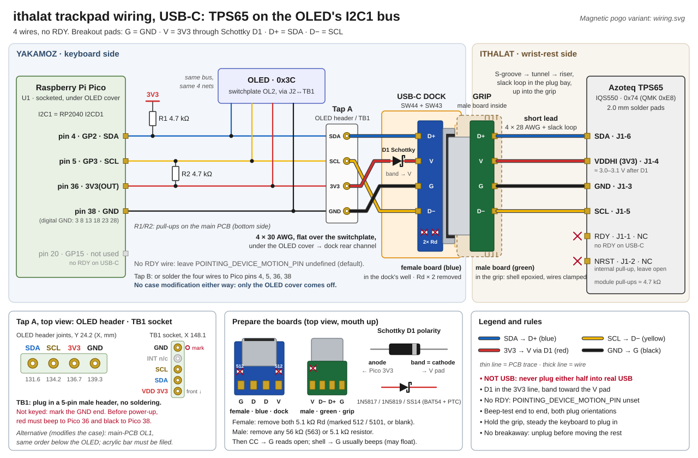

# Wiring ithalat

How to connect the TPS65 trackpad in the ithalat rest to the [Yakamoz](https://github.com/ozkan/Yakamoz) keyboard.

## TL;DR

- **Four wires:** SDA, SCL, 3V3, GND, from the Pico's I2C pins. The OLED shares them and keeps working. The magnetic pogo can add a fifth, optional RDY.
- **Path:** dock → magnetic pogo or USB-C → short pigtail → TPS65. The dock replaces SW44 + SW43. Nothing is cut, filed or drilled.
- **3.3 V only.** USB-C needs a series Schottky diode on 3V3.
- **Your steps:** pogo: Steps 1, 2a, 3, 4. USB-C: Steps 1, 2b, 3, 4 ([which one?](README.md#pick-your-connector)).
- **Test before power-up:** beep-test every wire first ([Step 4](#step-4-test-before-power-up)).

**Jump to**

- Before: [The wires](#the-wires) · [What you need](#what-you-need) · [Safety first](#safety-first)
- Build: [Step 1](#step-1-keyboard-side-both-connectors) · [2a pogo](#step-2a-magnetic-pogo-dock) · [2b USB-C](#step-2b-usb-c-dock) · [Step 3](#step-3-rest-side-trackpad-pigtail) · [Step 4](#step-4-test-before-power-up)
- After: [Plugging](#plugging-and-unplugging) · [Troubleshooting](#troubleshooting) · [Where to buy](docs/where-to-buy.md) · [More detail](#more-detail)

## The wires

| Signal (colour) | Pico pin | Pogo pin | USB-C pad | TPS65 pad |
|---|---|---|---|---|
| SDA (blue) | 4, GP2 | 1 | D+ | SDA (J1-6) |
| 3V3 (red) | 36, 3V3(OUT) | 2 | V, via Schottky | VDDHI "3V3" (J1-4) |
| GND (black) | 38 | 3 | G | GND (J1-3) |
| SCL (yellow) | 5, GP3 | 4 | D− | SCL (J1-5) |
| RDY (green, optional) | 20, GP15 | 5 | none | RDY (J1-1) |
| NRST | none | none | none | NRST (J1-2): leave open |

- **Same firmware** for both connectors.
- **No Pico soldering needed:** tap A has the same four nets, under the OLED cover ([Step 1](#step-1-keyboard-side-both-connectors)).
- **GND:** pin 38 or any digital GND (3, 8, 13, 18, 23, 28). Not pin 33 (AGND).
- **RDY** is on no header: solder it at the Pico. Pogo only.
- **Colours** follow Qwiic / STEMMA QT, as in the diagrams.
- **Board positions:** [full signal table](docs/wiring-details.md#full-signal-table).

Words used here

| Word | Meaning |
|---|---|
| TB1 | the trackball socket on the switchplate |
| OL1 | the spare OLED position on the switchplate (four holes) |
| J1 | the TPS65's ZIF flat-cable connector. Not used. |
| VDDHI | the TPS65's supply pad, silk "3V3" |
| NRST | the TPS65's reset pad. Leave it open. |
| n/c | not connected |
| CC resistors | tiny resistors on a USB-C board's CC contacts. A charger reads them and switches 5 V on, so you remove them. |
| liner | the paper film over the TPS65's adhesive |
| dock | the printed part that clips into the SW44/SW43 cut-outs |
| grip | the printed shell around the male USB-C board |
| pigtail | the short wire bundle from the TPS65 to the pogo plug or the grip |

Diagram: magnetic pogo

Diagram: USB-C

## What you need

- **Both:** 30 AWG silicone wire (keyboard), 28 AWG silicone wire (pigtail), 1.5 mm heat-shrink, a 3 mm sleeve, Kapton, hot glue. A 5-pin male header if you use the TB1 socket.
- **Pogo:** an N/S-keyed 5-pin 2.54 mm magnetic pogo pair, about 20.1 × 4.2 × 4.0 mm. A paint pen.
- **USB-C:** a small 4-pad female and male breakout board, a 1N5817 / 1N5819 / SS14 Schottky, 4 × M2x4 self-tapping screws, 2-part epoxy, two "NOT USB" labels.
- **Tools:** fine-tip iron (about 330 °C), 0.5 mm solder, flux, multimeter, tweezers, keycap and switch pullers. USB-C: hot tweezers or a second iron.

Full list: [docs/bom.md](docs/bom.md). Shops: [docs/where-to-buy.md](docs/where-to-buy.md).

## Safety first

> [!WARNING]
> **3.3 V only.** Use Pico pin 36, 3V3(OUT). Pins 39 (VSYS) and 40 (VBUS) are 5 V: never connect them. The TPS65 maximum is 3.6 V.
>
> **USB-C diode:** anode (plain end) to Pico 3V3, **band to the female board's V pad**.

> [!IMPORTANT]
> **Never plug the USB-C halves into real USB.** The grip in a laptop or charger can kill the TPS65. Label both halves "NOT USB".

- **Unplug the keyboard's USB** while you work. Touch something grounded first.
- **Leave NRST unconnected.**
- **Never bridge Pico pins 36–38.** Pin 37 (3V3_EN) to GND turns the 3V3 regulator off.
- **Pogo joints: 2–3 s each.** Heat weakens the magnets.

## Step 1: Keyboard side (both connectors)

1. **Unplug USB.**
2. **Test-fit your printed dock.** Pogo: your pair must match `DOCK_CONN_W/H/D`. USB-C: see [Step 2b](#step-2b-usb-c-dock), Part A.
3. **Pull SW44 and SW43**, the two centre keys of the front row. Hot-swap: nothing to desolder. Their keys go dead; trackpad taps replace them.
4. **Remove the OLED cover** (4 screws).
5. **Pick a tap point.** Take the first free one:

| Tap | Where | Pin order |
|---|---|---|
| A1 (best) | Switchplate TB1 socket, with a male header | back to front: GND, INT (n/c), SCL, SDA, VDD |
| A2 | OLED module header joints | left to right: SDA, SCL, VCC, GND |
| A3 | Switchplate OL1 holes, if empty | back to front: GND, VCC, SCL, SDA |
| B | Pico pins | 4 SDA, 5 SCL; 36 3V3, 38 GND |

> [!WARNING]
> **The TB1 header is not keyed.** Reversed, it puts −3.3 V on the pad. Mark its GND end before you plug it in. After every re-seat, beep red → Pico pin 36 and black → pin 38 (USB-C: red at the diode's anode).

- **Do not tap the J2 ↔ TB1 link.** Its pin 4 is RGB data.

6. **Pogo only, optional:** solder a green wire to Pico pin 20 (GP15), the Pico's front-left corner pin.
7. **Lay the wires flat** on the switchplate, under the cover. Bring them out under its front edge into the dock's rear channel. Tack them with Kapton.
8. **Keep them off** the Pico's USB connector and out from under the OLED module.
9. **Refit** the OLED module (same way round) and the cover.

More: [tap details](docs/wiring-details.md#tap-points-in-detail), [wire routes](docs/wiring-details.md#where-wires-can-and-cannot-run).

## Step 2a: Magnetic pogo dock

> [!WARNING]
> **Use an N/S-keyed pair.** A pair that mates either way round is unsafe: reversed, it puts 3V3 on SCL. Check that yours repels when reversed (step 1).

1. **Mark pin 1.** Mate the halves (reversed, they must repel). Paint a dot on the same end of both: pin 1, SDA, typist's left.
2. **Thread the wires** (1.5 mm heat-shrink on each) through the rear channel and out of the front pocket.
3. **Solder the flat-pad half:**
   - 1 SDA blue · 2 3V3 red · 3 GND black · 4 SCL yellow · 5 RDY green (or empty).
   - 2–3 s per joint.
   - Shrink the tubing over each joint.
4. **Beep** each pad to its tap ([Step 4](#step-4-test-before-power-up)).
5. **Press it in:** flat face toward the rest, flush, pin 1 on the left seen from the rest. Hot glue over the tails.
6. **Clip the dock in** until the clips snap. It sits flat; no wire is pinched. To remove: one straight pull, about 20 N.

More: [receptacle notes](docs/wiring-details.md#pogo-receptacle-notes).

## Step 2b: USB-C dock

This is the keyboard half. You build the grip (the rest half) in [Step 3](#step-3-rest-side-trackpad-pigtail), Part B.

**Part A: Prepare both boards**

1. **Measure both boards.** Set the `USBC_*` constants in [`config.py`](config.py), regenerate, print, test-fit.
2. **Female board:** remove both 5.1 kΩ CC resistors (marked 512 or 5101). Then CC legs to G read open.
3. **Male board:** remove any 56 kΩ (563) or 5.1 kΩ resistor.
4. **Beep each board:** no pad beeps to another.
5. **Female silk only "D, D"?** Mate the bare boards and beep each female D pad against the male's D+. The one that beeps is D+: mark it ([details](docs/wiring-details.md#usb-c-signal-mapping)).

**Part B: Dock (keyboard half)**

1. **Test-fit** the bare female board: its mouth sits flush with the floor of the well.
2. **Diode:** anode (plain end) to the red wire, band to the V pad. Heat-shrink both joints.
   - **Plan to hot-plug?** Put a 10 Ω (0805) resistor or a PTC in the red wire now, on the Pico side of the diode ([why](docs/wiring-details.md#hot-plug-usb-c)).
3. **Solder:** black → G, red (from the band) → V, blue → D+, yellow → D−. All shell legs must be soldered.
4. **Beep** the keyboard half ([Step 4](#step-4-test-before-power-up)).
5. **Seat the board** from the top, receptacle first. Wires out through the rear channel. Clip the dock in.
6. **Fit the retainer** flush and drive its two M2x4 screws.
7. **Label the dock** "NOT USB" on its top face.

Full steps and why: [USB-C in depth](docs/wiring-details.md#usb-c-in-depth).

## Step 3: Rest side (trackpad pigtail)

Parts A, C and D are the same for both connectors. Part B is per connector.

> [!NOTE]
> **Solder the connector end last.** It does not fit through the rest's tunnel.

**Part A: Pigtail (both connectors)**

1. **Cut the pigtail:**
   - 28 AWG, 120 mm each.
   - 5 wires for the pogo, 4 for USB-C.
   - Twist them.
   - Sleeve about 18 mm, starting 15 mm from the module end. Max 3.5 mm thick.
2. **Solder the TPS65:**
   - Touch side down, connector edge away from you.
   - Keep the liner on. Put Kapton over J1.
   - Pads, left to right, in the table below.
   - Lay the wires flat, pointing toward the module centre.

   | RDY | NRST | GND | VDDHI | SCL | SDA |
   |---|---|---|---|---|---|
   | green (pogo, optional) | none | black | red | yellow | blue |

3. **Insulate:**
   - Check for bridges.
   - Kapton over the pads, then a bead of hot glue.
   - Keep it all inside the solder well.
4. **Route:** groove → tunnel → riser → notch. The sleeve runs from the groove end to just before the riser.
5. **Glue the sleeve** into the S-groove (hot glue or neutral-cure silicone, not acetic RTV). Nothing above the ledge.

**Part B, pogo: Solder the plug**

1. **Cut each wire** with the plug mated (+3 mm).
2. **Solder** 1 SDA … 5 RDY, 2–3 s per joint.
3. **Keep it small:** within 3 mm behind the plug and 6 mm tall.
4. **Beep** end to end.

**Part B, USB-C: Build the grip**

1. **Cut the wires** with the bare male board plugged in: route + 12 mm slack loop + 3 mm.
2. **Heat-shrink:** 1.5 mm on each wire, for the pad joints. No sleeve where the grip clamps the wires.
3. **Solder:** black → G, red → V, blue → D+, yellow → D−, on the front half of each pad. Shrink each joint.
4. **Beep end to end, both ways up**, before you close the grip. The grip fits one way up only.
5. **Epoxy** the plug shell into the nose (2-part epoxy, not CA). Board pads up, against the push rib.
6. **Wires** over the push rib, down the slot. Close with two M2x4 screws from below. Let it cure.
7. **Beep again** with the grip closed.
8. **Label the grip** "NOT USB".

**Part C: Glass and module (both connectors)**

1. **Glass:** clean with alcohol, peel the liner, roll the module on from one short edge (no air), press 30 s on bare PCB. Bare variant: a thin film instead.
2. **Seat the module:** touch side up, connector edge to the keyboard. Press only in the middle. It must lie flat.

**Part D: Connect**

- **Pogo:** set the rest 1.5 mm from the keyboard, dock the plug. It must not touch the rest. Never lay it on the glass.
- **USB-C:** plug the grip in ([how](#plugging-and-unplugging)). It must float about 1.6 mm above the rest. If it touches, re-dress the slack loop.

More: [rest side in depth](docs/wiring-details.md#rest-side-in-depth), [grip in depth](docs/wiring-details.md#grip-full-steps).

## Step 4: Test before power-up

> [!IMPORTANT]
> **No power until the end-to-end test passes.** A reversed or mirrored half puts 3V3 on the pad's SCL.

USB unplugged, meter on beep.

**Pogo**

- [ ] Pads 1–5 ↔ Pico pins 4, 36, 38, 5, 20 (if wired): each beeps.
- [ ] Neighbouring pads do **not** beep.
- [ ] Rest half: each spring pin ↔ its TPS65 pad; NRST to nothing.
- [ ] Mated: Pico 4 ↔ SDA, 36 ↔ VDDHI, 38 ↔ GND, 5 ↔ SCL, 20 ↔ RDY.
- [ ] Pull-ups measured (see below).

**USB-C**

- [ ] Keyboard half: G ↔ pin 38, D+ ↔ pin 4, D− ↔ pin 5: each beeps.
- [ ] Diode mode, red on pin 36, black on V: 0.15–0.35 V. Swapped: open.
- [ ] No two pads beep to each other.
- [ ] Rest half: G ↔ GND, V ↔ VDDHI, D+ ↔ SDA, D− ↔ SCL; NRST and RDY to nothing.
- [ ] Mated **both ways up** with the bare male board, before the grip was closed (Step 3, Part B, step 4).
- [ ] Mated with the closed grip: pin 4 ↔ SDA, 5 ↔ SCL, 38 ↔ GND; diode 36 → VDDHI 0.15–0.35 V; no shorts.
- [ ] Pull-ups measured (see below).

How to measure the pull-ups

USB unplugged, meter on the 20 kΩ range.

1. **Red probe on 3V3, black on SDA:** Pico pins 36 and 4, or the matching tap-A points. Repeat for SCL. Swapped probes can read too low.
2. **Trackpad unplugged:** expect about 4.7 kΩ, or less if the OLED module adds its own.
3. **Trackpad alone:** VDDHI pad → SDA pad. About 4.7 kΩ means the module has pull-ups.
4. **Trackpad plugged in:** measure again. With USB-C this can read higher, because of the Schottky. Trust steps 2 and 3.

| Total, pad plugged in | Do this |
|---|---|
| about 1.5–3.3 kΩ | Nothing. |
| ≥ about 4 kΩ | Add 4.7 kΩ from SDA and from SCL to 3V3 at the dock (USB-C: to the V pad), or set `#define I2C1_CLOCK_SPEED 100000`. |
| < about 1.2 kΩ | Too strong. Remove one set (usually the OLED module's). |

Why: [pull-ups in depth](docs/wiring-details.md#pull-ups).

| You see | It means |
|---|---|
| 3V3–GND reading slowly rises | Normal (capacitors). Steady near 0 Ω is a short. |
| Pogo SDA↔RDY and 3V3↔SCL | Mirror-image half |
| Diode beeps both ways | Shorted or bypassed |
| Diode open both ways | Broken joint |
| Diode reads only reversed | Diode in backwards |
| USB-C works one way up only | Female wires one D pair: [see details](docs/wiring-details.md#beep-tests-usb-c) |
| Shell ↔ G does not beep | Floating shell: fine, do not bridge it |

**First power-up**

1. **Flash** the [firmware](firmware/README.md).
2. **Connect the trackpad first,** then plug in USB. (Unplug USB after flashing, if it is still in.)
3. **Look:** the OLED comes up as before. Nothing gets warm.
4. **Never above 3.6 V:** measure VDDHI–GND at the pads. Pogo 3.2–3.4 V; USB-C about 3.0–3.1 V (2.9–3.25 V is fine).
5. **Gestures:**
   - move;
   - tap = left click;
   - two-finger tap = right click;
   - two-finger drag = scroll;
   - press and hold about 0.5 s, then move = drag.
6. **Drift:** leave it 30 s, the cursor must not creep. Pogo: also do the [full drift check](docs/wiring-details.md#first-power-up) along the back and front edges.
7. **Finish:** [calibrate](firmware/README.md#calibration-30-seconds) and run the [checklist](firmware/README.md#test-checklist-after-flashing).

More: [tests in depth](docs/wiring-details.md#tests-in-depth).

## Plugging and unplugging

**Pogo**

- **Safest:** unplug USB, connect the pad, plug USB back.
- **Live plugging** is mechanically safe with an N/S-keyed pair. It may briefly glitch the OLED.
- **It breaks away** under a pull.
- **Re-init:** the firmware finds a live-plugged pad after about a second ([timing](firmware/README.md#hot-plug-behaviour-and-limits)). Without it, re-plug USB.

**USB-C**

1. **Plug in:** steady the keyboard with one hand. Hold the grip (never the wires) and push straight in, 5–20 N.
2. **Unplug:** brace a fingertip on the dock face beside the well, pinch the grip, pull straight back.
3. **No rocking**, no levering.

> [!WARNING]
> **USB-C does not break away.** Unplug before you move the rest.

- **Live plugging USB-C is fine:** GND mates first. The firmware finds the pad in about 1–1.5 s ([timing](firmware/README.md#hot-plug-behaviour-and-limits)).
- **If you hot-plug USB-C,** add a 10 Ω (0805) resistor or a PTC in 3V3, before the diode ([Step 2b](#step-2b-usb-c-dock), Part B, step 2).

More: [firmware hot-plug](firmware/README.md#hot-plug-behaviour-and-limits), [pogo](docs/wiring-details.md#hot-plug-magnetic-pogo), [USB-C](docs/wiring-details.md#hot-plug-usb-c).

## Troubleshooting

| Symptom | Check |
|---|---|
| `IQS5XX - get report failed` in the console | Power, wiring, pull-ups |
| No movement, no console messages | Re-plug USB with the pad connected |
| OLED or pad glitchy | `#define I2C1_CLOCK_SPEED 100000` (or 200000) |
| Cursor drifts near the back | Re-plug; then raise `TP_BACK_MARGIN` |
| Axes reversed | `AZOTEQ_IQS5XX_ROTATION_*` in firmware |
| USB-C VDDHI = Pico 3V3 | Diode shorted or bypassed |
| OLED freezes, charger in the dock | Unplug it; re-plug the keyboard's USB |
| Grip touches the rest | Re-dress the slack loop |
| Module rocks | Wire or glue on the ledge |

More: [electrical notes](docs/wiring-details.md#electrical-notes).

## Example parts and where to buy

Quick picks (checked 2026-11-15; prices and stock change):

| Part | Examples |
|---|---|
| USB-C male board (4 pads) | [Motorobit](https://www.motorobit.com/type-c-erkek-usb-sase) (TR, 7.42 TL) · [Tinkersphere TS3551](https://tinkersphere.com/mini-usb/3551-usb-31-type-c-male-breakout-board.html) (US) |
| USB-C female board (4 pads) | [Motorobit](https://www.motorobit.com/panel-tipi-type-c-disi-usb-sase-4-pin-siyah) (TR, 49.44 TL) · [TinyTronics](https://www.tinytronics.nl/en/cables-and-connectors/connectors/usb/usb-c-2.0-female-to-dip-adapter) (NL) · [Adafruit 5180](https://www.adafruit.com/product/5180) (US) |
| Magnetic pogo pair (5-pin, 2.54 mm) | [Motorobit](https://www.motorobit.com/5-pin-254mm-pogo-pin-manyetik-konnektor-takimi) (TR, 216.30 TL) · [Adafruit 5413](https://www.adafruit.com/product/5413) (US, US$6.95) |
| Schottky 1N5817 (USB-C) | [Motorobit](https://www.motorobit.com/1n5817-20v-1a-do-41-schottky-diyot) (TR, 1.24 TL) · [direnc.net](https://www.direnc.net/1n5817-1a-20v-schottky-diyot) (TR) |

> [!TIP]
> **Measure USB-C boards before you print.** Sizes vary between shops. Set the `USBC_*` constants in [`config.py`](config.py) and regenerate ([Step 2b](#step-2b-usb-c-dock), Part A).

All shop links, with notes, stock and the "do not buy" list, are in **[docs/where-to-buy.md](docs/where-to-buy.md)**:

- [USB-C connector parts](docs/where-to-buy.md#usb-c-connector-parts)
- [Magnetic pogo connector parts](docs/where-to-buy.md#magnetic-pogo-connector-parts)
- [DIY magnetic pogo parts](docs/where-to-buy.md#diy-magnetic-pogo-parts)
- [Shared parts](docs/where-to-buy.md#shared-parts-both-connectors): diode, wire, TPS65, glass, screws

Quantities and rough costs: [docs/bom.md](docs/bom.md).

## More detail

Everything else is in [docs/wiring-details.md](docs/wiring-details.md):

- [Conventions](docs/wiring-details.md#conventions) and [how the link works](docs/wiring-details.md#how-the-link-works)
- [Full signal table](docs/wiring-details.md#full-signal-table) with board positions
- [Keyboard side in depth](docs/wiring-details.md#keyboard-side-in-depth), incl. the [under-plate alternative](docs/wiring-details.md#under-plate-alternative-modifies-the-case)
- [Rest side in depth](docs/wiring-details.md#rest-side-in-depth): pocket, pigtail lengths, glass
- [Electrical notes](docs/wiring-details.md#electrical-notes): pull-ups, bus speed, [optional protection](docs/wiring-details.md#optional-protection-parts)
- [USB-C in depth](docs/wiring-details.md#usb-c-in-depth): the Schottky, [it is not USB](docs/wiring-details.md#it-is-not-usb-chargers-and-laptops), [RDY over SBU](docs/wiring-details.md#rdy-over-sbu-advanced)
- [Tests in depth](docs/wiring-details.md#tests-in-depth): QMK console, I2C scan
- [Other connectors](docs/wiring-details.md#other-connectors) and [ASCII diagrams](docs/wiring-details.md#ascii-diagrams)
- [Old section numbers](docs/wiring-details.md#old-section-numbers): where the old §1–§9 went
